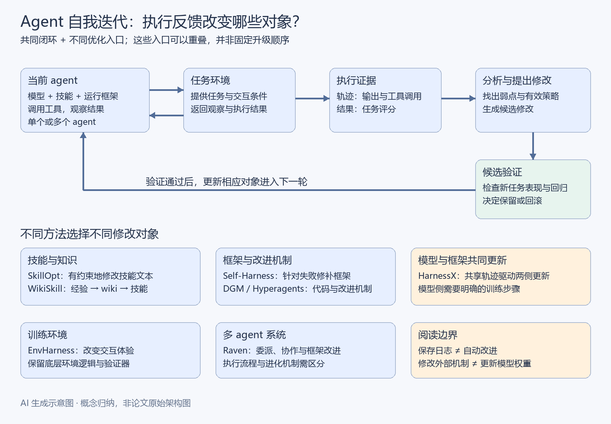

# Agent 自我迭代：从技能优化到模型与环境协同进化

一个 agent 能完成任务，并不意味着它能从任务中持续进步。很多系统虽然保留了日志，但下次仍会重复同样的错误；即使自动生成了一段“反思”，也未必会改变后续行为。要实现持续改进，需要把执行经验变成持久的修改，并验证这些修改是否有效。

近年来，一批研究开始把 agent 的技能文件、运行框架、自身代码、底层模型、训练环境以及多 agent 协作机制作为优化对象。它们共同回答一个问题：**怎样让系统利用过去的执行经验，改进下一次任务的完成方式？**

本文先解释共同的改进逻辑，再介绍 SkillOpt、WikiSkill、Self-Harness、Darwin Gödel Machine、Hyperagents、HarnessX、EnvHarness 和 Raven 八个方法。重点是理解各自的问题、机制与设计理由，不要求读者了解训练算法或实现代码。

## 一、先区分模型、agent 和运行框架

**模型**是根据输入生成输出的基础能力来源，其参数也称为权重。更新上下文中的一段说明，不等于更新模型权重。

**Agent**是围绕模型构建的任务执行系统。它不仅生成文字，还会读取信息、调用工具、观察结果，并决定下一步行动。

**Harness（运行框架）**是连接模型与任务环境的外层机制，包括提示词、工具接口、记忆、上下文管理、状态记录、重试与验证流程。它决定模型能看到什么、能做什么，以及失败后如何继续。技能通常属于这套外部机制中的一部分。

**Skill（技能）**把某类任务的程序性知识封装成可复用资源，例如操作步骤、适用条件、常见错误和检查规则。技能可以包含文本、脚本与其他资源；本文涉及的技能优化重点是其中的指令与流程。

因此，同一个模型配上不同工具、技能和控制流程，整体任务表现可能很不一样。自我迭代既可以发生在外部机制中，也可以进一步涉及模型训练。

本文使用一个贯穿示例：一个自动处理故障工单的 agent，需要读取问题、查询知识库、检查服务状态、提出修复建议并验证结果。它可能漏查版本号、重复执行失败命令、遗忘中间状态，也可能与其他 agent 交接不清。后文的工单案例均为**教学示例，不是对应论文的实验案例**。

## 二、自我迭代的共同闭环

多数方法都包含类似的闭环：

1. **执行任务。** 使用当前版本的 agent 完成一批任务。
2. **记录轨迹。** 保存模型输出、工具调用、工具返回、错误和最终结果。轨迹说明任务是怎样完成或失败的。
3. **分析问题。** 找到跨任务反复出现的弱点，也总结有效做法。
4. **提出修改。** 改技能、代码、环境或模型中的某个部分，得到候选版本。
5. **评估候选。** 检查新版本是否提高任务表现，以及是否破坏已有能力。
6. **保留经验。** 保存有效版本和必要的优化历史，为后续改进提供依据。

这里要区分三类任务数据：训练或适应任务用于发现问题和提出改动；验证任务用于选择候选版本；最终测试任务用于评估改进能否推广。**没有参与生成某次修改的验证样本，称为留出样本。** 不过反复依据同一验证集挑选版本，也可能逐渐适应该验证集，因此仍需要独立测试。

回归测试则关注另一件事：修复新问题后，过去已经能完成的任务是否仍然能完成。新版本在一个失败案例上成功，不能证明它整体更好。

*图：AI 生成示意图。实线展示任务执行、轨迹反馈与候选验证的共同关系；底部说明哪些对象可以被修改。模型权重更新需要额外的训练步骤，不能由日志保存自动完成。该图是概念归纳，不是任一论文的原始架构图。*

这些方法可以沿“修改范围扩大”来理解，但不是必须依次经历的升级阶段。选择哪个对象，应取决于瓶颈在哪里。

## 三、SkillOpt：把技能文件当作可以优化的外部参数

### 问题：人工改说明，为什么难以稳定变好？

当工具和整体流程已经可用，但 agent 经常漏步骤、误用规则，技能文件是直接的改进入口。然而，“多补几条提醒”可能造成重复、冲突和不断增长的指令，读起来合理的修改也可能降低实际表现。

### 方法：小幅修改，并用验证结果决定是否接受

SkillOpt 固定目标模型与运行框架，让目标 agent 按当前技能执行任务。另一个优化模型读取带评分的成功与失败轨迹，提出增加、删除或替换文本的候选编辑。系统合并、筛选这些编辑，并限制每轮的修改量。

候选技能只有在留出验证集上严格优于当前技能时才接受。被拒绝的改动也作为后续优化的负反馈保留下来。最终产物是一份可部署的技能文件，目标模型权重保持不变。[微软研究说明](https://www.microsoft.com/en-us/research/blog/skillopt-agent-skills-as-trainable-parameters/)

### 为什么这样设计？

小幅编辑让前后版本保持可比较，也降低一次改坏多条规则的概率；验证门槛把“修改理由是否动听”转换为“任务表现是否改善”。所谓“训练技能”，这里指文本空间中的迭代优化，并不是对 Markdown 文件做神经网络的梯度更新。

**教学示例：**工单 agent 经常在确认软件版本之前套用修复方案。候选技能增加“先查版本，再匹配兼容方案”的步骤，随后检查它在另一批工单上是否提高正确率，是否引入不必要的查询成本。

**适用边界：**技能能指导已有能力的使用；如果系统缺少查询版本的工具，仅增加文字规则无法补齐这个能力。理解和执行新规则的能力也受目标模型限制。

## 四、WikiSkill：先沉淀经验知识，再生成可执行技能

### 问题：为什么只有日志和技能还不够？

原始日志细节多，直接反复读取成本高；技能文件需要简洁，不能承载所有探索历史。如果经验只散落在日志和历次修改中，后续优化容易重复发现旧问题，或重试已经无效的方案。

### 方法：把经验、知识与操作规则分成三层

WikiSkill 设置三层：原始层保存执行轨迹；wiki 层把经验整理成持久知识；技能层保存供 agent 执行的程序性规则。每轮由执行 agent 产生轨迹，wiki 维护者整合经验，技能提议者结合 wiki 与轨迹提出更新，再通过验证与回滚机制筛选技能。

关键区别是：技能更新被回滚时，wiki 仍保留积累的知识，后续改进可以继续利用它。[WikiSkill 论文](https://arxiv.org/abs/2608.27454)

### 为什么需要中间的 wiki？

“为什么这样做”与“执行时怎样做”需要不同表达。wiki 可以保存适用条件、失败证据和修改结果；技能则把较成熟的知识压缩成简洁流程。这样既保留探索积累，又不要求每次任务都携带完整历史。

**教学示例：**wiki 记录某类故障在不同版本上的成因，以及几次修复失败的原因；技能只保留“先确认版本，再按对应分支诊断”的操作路径。如果某次合并规则效果不好，回滚技能并不需要抹掉这次失败的经验。

**适用边界：**经验库也需要维护，错误归因可能被持久保存。整理出知识不等于知识正确，技能仍须验证；不同模型执行同一技能的效果也可能不同。

## 五、Self-Harness：把失败模式变成运行机制的修改

### 问题：为什么提示词里的提醒可能没有用？

有些失败发生在系统运行方式上。例如工具输出没有被正确传回模型，状态没有跨调用保存，或者重试流程允许重复执行同一条失败命令。这类问题往往需要修改框架组件。

### 方法：挖掘弱点、提出补丁、进行回归验证

Self-Harness 由三步构成：从执行轨迹中挖掘模型特有的失败模式；针对这些模式生成多样但尽量小的框架修改；通过回归测试决定是否接受候选。改进对象是围绕模型的运行框架，底层模型可以保持固定。[Self-Harness 论文](https://arxiv.org/abs/2606.09498)

### 为什么要针对具体模型的弱点？

不同模型的工具使用、状态处理和验证习惯并不一样。根据真实轨迹修改，可以把框架的设计与当前模型的具体行为联系起来，而不是不断添加泛化的“谨慎行事”说明。

**教学示例：**工单 agent 连续重复同一个失败命令。候选框架增加重复调用检测：遇到相同命令和相同错误时，将信息返回给模型，要求重新诊断。随后既测原来的失败工单，也测确实需要合法重试的任务。

这与 SkillOpt 的区别在于，优化对象从技能文本扩大到了执行机制。以上检测器只是解释该类修改的示例，不代表论文一定采用了这一实现。

**适用边界：**可修改范围扩大后，更容易引入跨任务副作用。一个合理的“防重复”机制也可能阻止正常操作，因此回归验证是方法的重要组成部分。

## 六、Darwin Gödel Machine：保存多个后代，探索不同改进分支

### 问题：为什么只保留当前最好版本可能限制探索？

一种直接做法是每轮修改当前最好版本，然后继续修改它。但某些结构调整短期得分不高，却可能为后续能力提供基础；单一链条容易丢失这些探索方向。

### 方法：维护一个不断扩展的 agent 版本档案

Darwin Gödel Machine，简称 DGM，让编码 agent 修改自身实现，用编码任务评测后代，并维护多个 agent 变体的档案。后续迭代可以从档案中的不同版本出发，继续生成和测试新版本。

其“Darwin”体现为变体、选择和分支探索；“Gödel”关联自我修改的思想。这里依据实验评测验证能力，并不要求像理论上的 Gödel Machine 那样形式化证明每次修改一定有益。基础模型保持冻结。[DGM 项目说明](https://sakana.ai/dgm/)

### 为什么编码任务特别适合这种设计？

编码 agent 的目标是写好代码，而修改自己的工具与流程也是编码任务。任务能力和自我修改能力有一定对齐关系。但这种关系不能直接推广到任意任务领域。

**教学示例：**工单 agent 出现两个后代：一个加强日志检索，另一个加强状态验证。它们不必立刻合并成唯一版本，后续可以分别探索其潜力，再用评测比较。

**适用边界：**维护和评测多个分支增加成本。保留多样性提供了更多探索机会，却不保证最终持续进步；效果仍取决于修改质量、任务分布和评估方式。

## 七、Hyperagents：连“如何改进自己”也允许变化

### 问题：做任务更强，是否意味着更会改进自己？

对于编码任务，两者可能相关。但一个更会回答业务问题的 agent，未必更擅长设计下一轮改进实验。如果改进方法始终由人工固定，任务 agent 的进步也可能受限于这个固定机制。

### 方法：把任务 agent 与 meta-agent 放进可编辑程序

Hyperagents 将执行目标任务的 task agent 与负责修改系统的 meta-agent 整合进同一个可编辑程序。meta-agent 可以修改任务 agent，也可以修改自身产生后续改进的程序。

这称为元认知自我修改：优化的不仅是任务行为，还有生成未来改进的机制。论文在 DGM 基础上实现 DGM-Hyperagents，观察到持久记忆和性能跟踪等改进机制在搜索过程中出现。[Hyperagents 论文](https://arxiv.org/abs/2603.19461)

### 为什么这是更深一层的迭代？

普通自我改进是在既定规则下寻找更好的执行方法；Hyperagents 还让产生改进的方法成为候选修改对象。例如，分析哪些失败、怎样利用历史结果，也可以被重新设计。它扩大了改进空间，但不能据此推断系统会无限加速。

**教学示例：**起初每次失败只触发一条局部补丁。经过迭代，meta-agent 可能增加历史问题分类和修改结果记录，让下一轮提议更有针对性。这是帮助理解两层机制的假设例子。

**适用边界：**改进机制本身被修改后，归因和验证更复杂。系统仍需要可信的任务反馈；能生成更多修改，不等于能产生更多有效修改。

## 八、HarnessX：让运行框架与模型从同一批经验中共同进步

### 问题：框架已经找到了好策略，模型为什么仍会执行不好？

运行框架可以提供工具和流程，但固定模型可能仍不善于选择工具、构造查询或判断停止时机。继续增加外部指令未必能解决所有执行能力问题。

### 方法：同一批轨迹驱动两类更新

HarnessX 将运行框架组织成可组合组件，并利用执行反馈演化框架。其模型—框架协同进化机制使用共享轨迹缓冲区：框架侧分析轨迹并提出结构修改；模型侧利用带奖励的轨迹进行强化学习训练。两侧更新完成后，新的模型与框架组合进入下一轮执行。

模型训练使用 cross-harness GRPO，即跨框架版本的组相对策略优化。同一任务在不同框架版本下产生的轨迹被放进同组，通过任务奖励差异形成训练信号。[HarnessX 论文第 5 节](https://arxiv.org/html/2606.14249v1#S5)

### 为什么要同时更新两侧？

框架探索改变了模型执行任务的方式，能够产生不同策略的轨迹；模型训练则有机会把有效行为内化到参数中。随后，更好的模型又为下一轮框架优化提供新的行为和证据。外部机制与内部能力因此可以相互促进。

**教学示例：**新框架引导工单 agent 先查服务依赖再定位故障。如果模型仍经常误选查询动作，训练可以利用任务评分与执行轨迹改善这种选择；更新后的模型再与框架一起接受评测。

**适用边界：**这需要模型训练权限、算力和训练接口。普通推理 API 的调用日志不会自动改变模型权重。新增训练也意味着需要管理模型版本，并验证模型与框架的兼容性；“有轨迹”并不等于“有可靠训练数据”。

## 九、EnvHarness：让练习环境继续针对 agent 的弱点

### 问题：为什么 agent 的训练环境也需要调整？

固定环境在早期能提供有用练习，但 agent 掌握其中的套路后，新增学习价值可能下降。另一方面，重建环境和可靠验证器通常需要较高工程成本。

### 方法：在原环境外增加可编程组件

EnvHarness 用插件式组件包装静态环境，在保留底层逻辑和原有验证器的条件下改变交互体验。负责设计的 EnvRigger 观察 agent 轨迹，诊断弱点，生成针对性的环境组件，并通过新执行过程验证。

可以改变的体验包括初始条件、观察信息或可用动作；随着 agent 改进，再继续调整环境。[EnvHarness 论文](https://arxiv.org/abs/2608.19880)

### 为什么保留原有验证器？

变化的是练习条件，而判断任务是否完成仍需保持可信。如果环境变了，评分标准也随意改变，就难以判断进步来自能力提升，还是任务被改容易了。保留验证器也能复用原环境中已有的评测基础。

**教学示例：**模拟工单环境最初提供完整日志，之后可以加入信息缺失、不同初始状态等条件，促使 agent 主动补充诊断证据。但最终仍需检验它是否完成了正确诊断。

**适用边界：**环境变化不应仅追求更难，而应提供有价值的练习。无效难度或不符合真实任务的变化，可能训练出错误习惯。环境自身的适应也不自动意味着模型权重被更新。

## 十、Raven：把优化范围扩展到多个 agent 的协作

### 问题：单个 agent 很强，组合起来为什么仍会失败？

复杂任务需要研究、编码、设计等不同能力。即使每个参与者都能做好局部工作，整体仍可能因拆分错误、依赖不清、信息交接丢失或结果整合不足而失败。

### 方法：组织不同执行能力，并改进其框架

Raven 将自身定位为“harness 的 harness”：围绕长期记忆、工具、技能和工作流，组织不同领域的 agent。它可以委派任务或协调多个 agent 的共同工作。

官方项目说明还区分了不同改进路径：Raven Evolver 是使用 Raven 作为库、依据基准评测筛选框架修改的独立工具；项目同时描述了运行时的策略模块与 Curator 修改机制。理解 Raven 时，应区分执行协作与框架改进，不把所有进化都理解成任务 agent 在每次调用中自动训练自己。[Raven 官方项目](https://github.com/EverMind-AI/Raven)

### 为什么协作层值得成为优化对象？

整体表现依赖任务如何拆分、分配和整合。局部 agent 的改进不能完全消除协作问题。因此，这一方向同时关心执行者能力与组织执行者的方法。但具体哪些编排规则已经自动演化，需要结合项目版本与实验证据确认。

**教学示例：**研究 agent 给出故障原因，编码 agent 编写补丁，验证 agent 检查结果。若编码开始前没有拿到可靠诊断，问题可能在依赖顺序或交接协议，不能仅归因于编码模型。

**适用边界：**这是持续变化的工程项目，其定位、公开实现与能力宣传需要区分。更多 agent 也意味着更高协调成本，数量增加并不能直接保证整体能力提高。

## 十一、如何比较八种方法

| 方法 | 核心优化对象 | 主要解决的问题 | 核心设计理由 |
|---|---|---|---|
| SkillOpt | 技能文本 | 程序性规则反复出错，人工编辑不稳定 | 用小幅编辑和验证门槛控制修改 |
| WikiSkill | 经验 wiki 与技能 | 经验分散，后续迭代难以继承 | 分离原始经验、积累知识和执行规则 |
| Self-Harness | 运行框架 | 工具、状态、验证和控制流程缺陷 | 把具体失败模式转成可测试补丁 |
| DGM | agent 代码与版本分支 | 单一路线限制探索 | 保存多种变体作为后续探索起点 |
| Hyperagents | 任务机制与改进机制 | 固定优化方法成为瓶颈 | 允许生成改进的程序本身变化 |
| HarnessX | 框架与模型参数 | 外部策略与模型执行能力相互限制 | 同一批经验驱动结构更新和模型训练 |
| EnvHarness | 环境外层组件 | 固定练习难以继续针对弱点 | 调整交互条件，同时复用原验证基础 |
| Raven | 多 agent 系统及框架 | 局部能力与整体协作不匹配 | 组织异构能力，并评估框架改进 |

前五种方法主要围绕技能、代码和优化机制展开，不必训练底层模型；HarnessX 明确连接框架进化与模型参数训练；EnvHarness 改变学习经验来源；Raven 把视野扩大到多个执行者。它们可以组合，但不能把不同方法的全部机制简单拼成一套统一算法。

## 十二、趋势的意义与证据边界

这些工作的共同变化，是把执行轨迹从“事后排错材料”转成下一轮优化的输入。开发者除了设计初始 agent，还需要决定哪些对象允许修改、用什么反馈衡量改善、怎样保存版本与经验。

这种变化可以在两个层面产生积累：

- **系统层面的积累：**技能、知识、工具和流程得到更新，模型权重仍保持固定。
- **模型层面的积累：**执行经验通过明确的训练流程进入参数更新，例如 HarnessX 的协同进化。

判断一个系统是否实现了有意义的自我迭代，应检查：经验是否产生持久改动；新版本是否经过独立评估；已有能力是否得到保留；收益是否超过新增执行、训练和维护成本。一次反思、一份更长的技能文件或一次成功的自我修改，都不足以单独证明持续进步。

研究中的“提升”还需要结合任务范围、模型、基线、数据划分和成本理解。相对提升百分比与成功率提高的百分点也不能混用。本文重点解释机制，不将某项基准的最高收益当作真实业务中的效果承诺。

学习这八个方法时，可以始终围绕三个问题重建理解：**系统从经验中提取了什么？这些信息改变了哪个对象？什么证据支持这个改变值得保留？** 这三件事连接起来，才形成可积累的自我迭代。

## 参考资料

本文以 AlphaSignal 2026 年 10 月 4 日关于自我进化 agent 技术栈的专题为主题线索，结合以下论文与官方资料整理。方法机制、教学示例和本文评价已在相应段落中区分；项目状态依据整理时可见资料，不代表固定不变的能力清单。

1. [SkillOpt：微软研究介绍](https://www.microsoft.com/en-us/research/blog/skillopt-agent-skills-as-trainable-parameters/)；[论文](https://arxiv.org/abs/2605.23904)。
2. [WikiSkill: Compiling Agent Experience into Persistent Knowledge for Skill Evolution](https://arxiv.org/abs/2608.27454)。
3. [Self-Harness: Harnesses That Improve Themselves](https://arxiv.org/abs/2606.09498)。
4. [Darwin Gödel Machine：Sakana AI 项目介绍](https://sakana.ai/dgm/)；[论文](https://arxiv.org/abs/2505.22954)。
5. [Hyperagents 论文](https://arxiv.org/abs/2603.19461)；[Meta 官方代码](https://github.com/facebookresearch/HyperAgents)。
6. [HarnessX: A Composable, Adaptive, and Evolvable Agent Harness Foundry](https://arxiv.org/abs/2606.14249)。
7. [EnvHarness: Awakening Static Worlds for Agent Learning](https://arxiv.org/abs/2608.19880)；[Google Research 官方代码](https://github.com/google-research/envharness)。
8. [Raven：EverMind 官方项目](https://github.com/EverMind-AI/Raven)。
