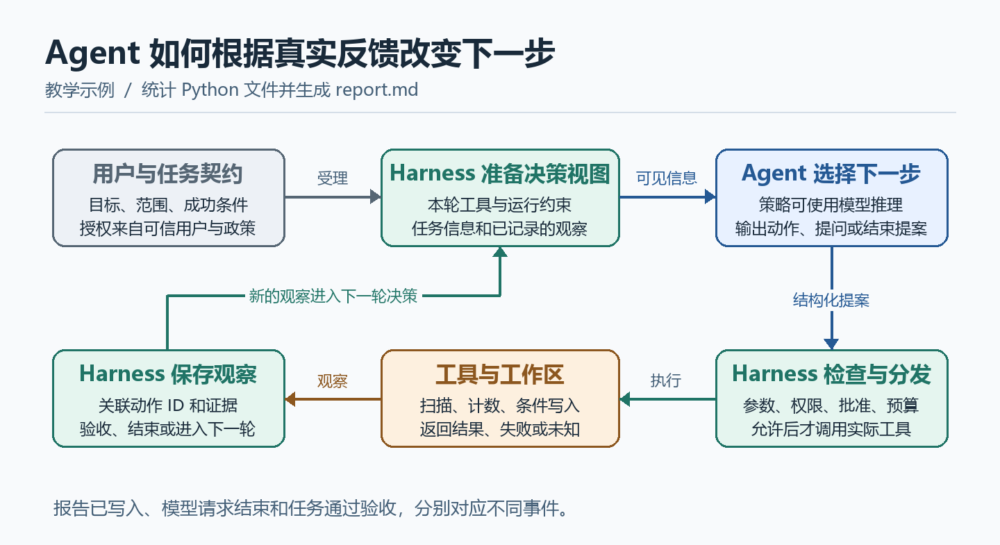

# Agent：目标驱动的决策循环与职责边界

用户说“统计当前项目的 Python 文件，列出行数最多的三个文件，并生成 `report.md`”。模型可以解释统计办法，但文件清单、行数和写入结果都来自实际环境。一次扫描还可能发现编码错误、目录越界或已有报告。这时系统需要根据刚获得的事实决定继续、改方案、请求用户确认还是停止。**Agent 的核心问题是如何围绕目标，根据观察选择下一步。**

本文先把 Agent、模型和 Harness 的名字拆开，再跟着这份报告走完一次闭环。最后用伪代码把决策接口和运行接口接起来，并用机器狗巡检说明同样的分工如何迁移到有外部副作用的任务。案例和伪代码均为教学设计。

## 1. 先约定 Agent 的两种口径

| 名称 | 本文采用的含义 | Python 报告任务中的例子 |
| --- | --- | --- |
| 广义 Agent 系统 | 能接收目标、操作环境并根据反馈推进任务的完整应用 | 命令入口、任务决策、模型、Harness、工具和交付界面组成的报告助手 |
| 狭义 Agent | 决策层。结合任务目标、当前观察和可用能力，产生下一步提案 | 看到统计结果后决定生成报告，看到覆盖冲突后请求确认 |
| LLM | 大语言模型。根据本次输入生成文本或结构化输出 | 理解“最长”可能指行数，或者生成工具调用参数 |
| Harness | 承载一次运行的框架。组织模型和工具调用、执行规则并记录结果 | 注入工作区范围，检查路径和授权，执行并记录写入 |
| Tool | 可以被程序调用、具有明确输入和输出的具体能力 | 在允许范围内统计 Python 文件，原子写入报告 |
| 环境 | 被观察或改变的外部系统 | 工作区文件、版本或文件摘要、权限和现有报告 |

后文单写 **Agent** 时采用狭义口径。不同框架可能把整个循环、工具分发和存储都封装在一个 `Agent.run()` 或名为 `agent.py` 的模块里。判断职责时看实际输入、输出和授权主体，文件名和 API 名称提供的是代码定位线索。

**一次调用模型**会把输入变成文本或结构化输出。**一次工具调用**会把参数交给程序，得到外部观察或引起状态变化。**一次 Agent 运行**把这些步骤串成反馈回路，后续动作可由前面的结果改变。固定地“统计 → 渲染 → 保存”的程序也能做这个任务。增加 Agent 的理由是用户表达、环境反馈和异常路线足够多，事先很难用一套固定分支覆盖。具体计数仍适合交给确定性程序。固定工作流也可包含局部 Agent 决策，自治程度取决于系统把多少路径选择交给策略。

## 2. 从用户目标到下一步动作

用户提供的是期望，程序需要一个可传递、可校验的**任务契约**。在本例中，用户和工作区规则已经明确以下条件。

| 契约字段 | 取值与语义 |
| --- | --- |
| 目标 | 统计工作区中符合范围的 `.py` 文件，列出按行数排序的前三个并生成报告 |
| 范围 | 当前授权工作区，跳过 `.git`、`.venv` 与符号链接 |
| 统计口径 | 按 UTF-8 解码后分行，空行和注释计入。行数相同时按相对路径排序，少于三项就列出实际项 |
| 异常口径 | 有读取失败时记录文件及原因。可交付部分结果，报告和最终状态都明确标为部分完成 |
| 产物和权限 | 输出 `report.md`。首次创建在本任务已授权范围内，覆盖已有文件须额外确认 |
| 完成条件 | 报告与一次可追溯的统计结果相符，并有写入后的校验记录 |

收到结构化输入时，程序可以直接解析字段和检查类型。收到长提示词时，接收请求、读取可信元数据、拼接上下文可以由程序完成。若目标或约束需要语义提取，可由 Harness 组织一次 LLM 调用，要求模型返回候选目标、要求和疑点，或由 Agent 在首次决策时分析原文。解析程序只能识别约定的结构，无法凭空理解自然语言的歧义。

例如，用户只说“最长文件”时，业务策略可以基于既定默认值提出“按行数”，或请求澄清。如果用户的原话和模型提取结果不一致，应回到原文。模型提取的“可写任意路径”之类字段没有授予权限的效力。运行边界来自受信任的用户授权、应用政策和工作区配置。

任务进入运行后，Agent 的决策可以拆成五种工作：

1. **理解目标和成功条件。** 把“生成报告”拆成获取真实统计、形成报告、确认文件落盘和回报结果，识别“前三个”的排序口径。
2. **规划与取证。** 决定先看什么，再用什么能力。例如先调用只读统计工具，再依据结果生成报告。小任务可以每步重算下一动作，较复杂任务可维护依赖计划。
3. **选择和构造动作。** 在 Harness 暴露的能力中选择工具，填写参数，必要时提出子任务、澄清问题或人工确认请求。工具请求本身只是提案。
4. **解释反馈和修订计划。** 区分“扫描完成”“扫描部分完成”“无权限”“文件发生冲突”等观察，决定是否交付部分成果、补充取证或走另一条合法路线。
5. **提出收尾。** 基于可引用的观察说明完成了哪些要求、哪些仍未知，并提出结束。运行时可根据验收规则拒绝证据不足的结束提案。

策略既可使用 LLM，也可包含确定性规则。例如当读取失败时，程序按契约自动标记部分完成。LLM 更适合解释用户意图、处理未预设的反馈和组织最终表达。无论策略如何实现，实际写入或发出命令都需要经过执行边界。

## 3. 决策看到的状态与系统实际知道的状态

要根据反馈决策，首先要区分“发生了什么”和“Agent 看到了什么”。环境里已经存在某个文件，是世界状态。工具按权限扫描后返回路径、行数和错误清单，是**观察**。模型本轮收到的目标、工具说明、观察摘要等内容，是**上下文**。即使模型已经看到旧的 `report.md` 状态，另一个进程也可能在执行前改动它。

| 对象 | Agent 如何使用 | 谁保存或裁决 |
| --- | --- | --- |
| 任务目标和业务约束 | 解释期望、排序优先级、提出澄清 | 原文、结构化任务契约和修订事件由应用或 Harness 管理 |
| 计划、假设和未决问题 | 维护任务进度，决定哪个假设需要证据 | Agent 产生语义内容，Harness 按运行的状态协议保存必要部分 |
| 工具结果与证据引用 | 根据成功、失败、拒绝或未知更新判断 | 工具报告实际观察，Harness 关联调用、验证结构并存储记录 |
| 权限、预算和取消信号 | 决策时参考剩余额度，选择可行的路线 | Harness 在执行点根据可信状态强制检查 |
| 跨任务记忆 | 建议召回项目约定或提出候选经验 | 记忆服务与治理流程负责作用域、留存和发布，Harness 控制载入与写入路径 |
| 模型上下文 | 接收筛选后的任务信息和反馈 | Harness 组织、裁剪与传入，Agent 可提出召回重点或辅助生成摘要 |

消息历史、当前上下文、恢复检查点和长期记忆可以相互引用，但用途不同。聊天历史记录发生过的交互，检查点服务于恢复执行，长期记忆服务于以后任务。即使都用同一种结构化数据保存，也要分别决定写入权限、有效期、检索范围和可信程度。

可以把一次决策抽象成：

$$a_t = \pi(g, o_{\le t}, b_t, u_t)$$

$g$ 是目标， $o_{\le t}$ 是截至第 $t$ 步的可用观察， $b_t$ 是 Agent 当前的假设或计划， $u_t$ 是本轮可见的能力和运行约束， $\pi$ 是决策策略， $a_t$ 是动作或结束提案。这是接口抽象。它不假设 Agent 能获取环境的全部状态，也不表示每一轮都由 LLM 完成。提案只有在 Harness 接受并实际分发后才可能改变环境。下一条观察可以来自执行器、权限检查器、用户或外部服务。



图 1。AI 生成示意图。蓝色区域是狭义 Agent 的决策，绿色区域是 Harness 的组织和治理。沿实线看动作提案如何到达工具，沿底部回路看实际结果怎样变成下一轮可用的观察。

## 4. 把一份报告的执行轨迹拆开

下面是一条假设轨迹。行数、路径和返回值仅用于说明数据如何传递。

| 时点 | Agent 提出的下一步 | Harness 与工具实际做的事 | 回到下一轮的观察 |
| --- | --- | --- | --- |
| 建立任务 | 如有歧义先澄清，否则先统计 | 从授权工作区建立任务契约，准备工具说明并调用策略 | 目标、统计口径和允许的能力 |
| 第一次决策 | `ToolCall("scan_python", {})` | Harness 绑定工作区和范围。扫描工具枚举、解码和计数 | 结果 `scan-17`，12 个候选，11 个成功统计，1 个解码失败。前三名带路径与行数 |
| 第二次决策 | `ToolCall("write_report", {scan_ref: "scan-17"})` | 检查统计引用属于本次运行。发现已有 `report.md`，持久化待批准动作，不执行覆盖 | `waiting_approval`，说明目标、证据及覆盖范围 |
| 用户批准后 | 恢复原提案 | Harness 校验批准绑定的动作及文件版本，再用统计结果渲染并写入，读回校验 | 写入证据 `write-21`，报告反映 11 项成功和 1 项未知 |
| 收尾 | `Finish([ "scan-17", "write-21" ])` | 核对统计引用、报告内容、写入证据和已知缺口 | `completed_partial`，用户看到报告路径、统计范围和解码缺口 |

如果用户拒绝覆盖，Harness 记录拒绝并把它作为观察。Agent 可以报告已有统计及阻塞点，或在用户授权允许时请求采用别的路径。如果批准后原文件又被修改，运行时以冲突处理，旧批准不会自动适用于新版本。如果解码失败且任务契约要求完整统计，则同一批观察只能支持未完成或继续取证。

这条轨迹回答了“谁在调用模型”的两个层次：

- **决策归属。** 理解目标、提出动作和解释结果是 Agent 策略的工作，因此常说“Agent 用模型做决策”。
- **程序调用链。** 本文把模型 API 的网络调用放在 Harness 的 Provider 适配器里。Agent 通过注入的接口发起推理请求，适配器选定配置、发送请求并记录用量。框架也可由 Runner 先调模型再把候选动作交给策略判断。
- **执行归属。** 模型返回工具名和参数。Harness 解析、鉴权和分发。扫描脚本或文件服务真正读写文件。工具在 MCP Server 或远端服务时，进程间通信仍是执行链的一部分。

Agent 也可以发起“请用户确认”的决策，Harness 则保存待确认动作并核验回复。如果动作触发硬性审批规则，即使 Agent 没有发起确认，Harness 仍须拦截。

## 5. 决策层伪代码与最小闭环

使用一个窄接口，把模型所做的事和程序能执行的事分开。`ToolCall` 携带工具名和参数，运行时分配动作 ID。`Ask` 携带待澄清的问题，`Finish` 携带证据引用，`Blocked` 携带阻塞原因。工具观察包含调用 ID、状态、数据摘要和证据引用。`view` 是 Harness 提供给 Agent 的只读决策视图，`llm` 是受管的模型调用接口。

```python
# 教学伪代码。这里描述的是 Agent 决策接口。
def decide(view, llm):
    if view.missing_required_meaning:
        return Ask(view.clarification_question)

    # 即使原计划希望覆盖，用户拒绝后也要更新路线。
    if view.last_observation.is_denied("write_report"):
        return Blocked("已有报告未获覆盖授权", view.scan_evidence)

    if view.last_observation.is_unknown("write_report"):
        return ToolCall("inspect_report", {"scan_ref": view.scan_ref})

    if view.last_observation.is_conflict("write_report"):
        return Blocked("批准所绑定的文件版本已变化", view.scan_evidence)

    # 模型可在当前观察基础上选择工具、提问或提交结束提案。
    return llm.propose(
        goal=view.goal,
        constraints=view.task_constraints,
        observations=view.observations,
        open_questions=view.open_questions,
        allowed_action_schemas=view.action_schemas,
    )
```

一次典型的 `llm.propose` 先返回 `scan_python`，看到可引用的统计结果后才返回 `write_report`。若文件写入结果不确定，`inspect_report` 只读核查报告与运行记录，核查后仍缺证据时应保留未知或阻塞状态。这里只用显式规则演示敏感反馈如何改变路线。生产实现还需要模型输出校验、任务隔离和重启恢复，详见 [[Harness：运行时架构、执行治理与职责边界|Harness 的运行控制与伪代码]]。

最短闭环可以只实现三个接口。`decide(view)` 提出动作，`dispatch(call)` 经过检查后执行并返回观察，`record(observation)` 让下次决策看见结果。计划、模型和工具分发可以在同一线程和进程中运行。只要接口职责清楚，就能分别测试：给定拒绝观察，策略是否避免重复提交同一写入；给定越权提案，分发器是否阻止实际副作用。

## 6. 选工具、加载 Skill 与委托子 Agent

决策层提出动作时，有几种形态容易混在一起。

- **Tool** 是具体能力。`scan_python` 接收参数并返回结构化统计。Agent 依据描述选择它，Harness 依权限分发，工具实现负责正确计数。
- **MCP** 是模型上下文协议，为宿主连接并调用外部能力提供标准接口。Agent 可以提出一个由 MCP 暴露的工具调用，宿主通过 MCP Client 把请求传给 Server。是否授权、如何限制副作用、如何消费反馈依然由相应组件负责。见 [[MCP 原理、调用链与最小实现|MCP 的 Host、Client 和 Server]]。
- **Skill** 是可复用的程序性知识，例如“生成文件统计报告时要记录统计范围和失败项”。Agent 可以根据任务选用。Harness 可以按规则发现、加载和提供内容。文本规则能够指导决策，真正的覆盖限制仍由执行门禁实现。见 [[Agent Skill：可复用的程序性知识与工程化运行机制|Skill 的发现与执行边界]]。
- **子 Agent** 有局部目标、状态和自己的决策反馈回路。父 Agent 可提出委托，例如让子 Agent 检查报告是否遗漏统计口径。Harness 负责创建受限运行、分配预算、传递上下文并关联结果。子 Agent 的输出也是观察，需要按证据评估。

是否要先用外层 LLM 判断“该找哪个 Agent”，取决于入口场景。可以通过 UI 直接选角色，可以按确定性规则路由，也可以让模型给出候选。路由决定工作交给谁，任务策略决定接手后怎样推进。只有一套决策策略和一条执行循环的系统，不需要额外路由模型。多 Agent 系统还要明确子任务输入、产物交接、并发写入约束与取消传播。

## 7. 内层动作循环和外层验收循环

`scan → write → finish` 描述的是动作循环。Agent 选择下一动作，Harness 获取并回填观察，再进入新一轮。较复杂的任务可以增加一个外层循环，检查一轮工作是否满足完整验收条件。例如外层发现报告漏掉失败的文件，便把这一缺口交回内层修改。

- **动作层**处理下一步选择，例如再扫描一次，或读取已有报告。
- **验收层**判断产物和目标是否匹配，可以组合确定性检查、独立模型评审和人工验收。
- **运行层**对两层施加预算、次数、截止时间与取消规则。预算耗尽后可交付已确认结果并标明终止原因。

所谓 **Loop Engineering** 在这里指怎样组织观察、路由、行动、反馈、验收和终止。循环代码可能由 Harness 执行，里面的决策节点仍由 Agent 策略负责。重新发出相同请求只有在失败可恢复、预算允许且副作用可以安全控制时才有意义。对于能从反馈中判断原因的任务，修订计划和机械重试是两件事。更细的状态和路由见 [[循环图工程：从状态演化到反馈控制|循环图工程]]。

## 8. 用巡检任务检查边界能否迁移

假设用户说“让机器狗 A 检查东区，结束后告诉我结果”。在只负责对话与设备交互的巡检 Agent 设计中，Agent 可追问缺失参数、提出查询设备状态或下发任务，并解释回执。Harness 或通信适配器负责查找连接、鉴权、关联 `requestId` 与回包、计时和记账。设备负责地图、导航与实际巡检，并拥有实际任务状态。

设备“已接收”仅确认接收请求。设备返回最终结果，或通过权威查询取得明确状态，才能支撑对应的完成报告。若发送后断线，Agent 可汇报“执行状态未知”并尝试查询，但不能靠上下文补出物理世界的事实。连接重建也不会自动证明先前请求是否执行。这个边界和文件写入超时相同：**Agent 选择如何查证，Harness 传递可查证的事实，实际状态由环境或业务系统提供。**

## 9. 资料、适用范围与复习

本文把曾分别讨论的任务路由、Agent Loop、工具反馈、Skill、记忆和验收，合在同一套教学接口中。多数决策步骤由模型产生候选动作，Runner 驱动外层循环。这是便于讲解的一种布局。事件驱动、固定图、Agent 自持循环以及托管式工具运行也可实现同样的责任分工。仅凭模型回答、验收摘要或单次成功轨迹，无法判断长期可靠性。

- 天枢是曾拆解过的实现对照。可以沿固定提交阅读任务契约、工具反馈和验收机制，观察真实项目怎样把部分职责放在一个执行模块中。本文伪代码使用自己的接口。[天枢任务数据模型](https://github.com/MJ-CJM/tianshu/blob/88462b2a6e46ae750e07697877613b9820bb5103/src/tianshu/models/edict.py) · [天枢 Agent 执行器](https://github.com/MJ-CJM/tianshu/blob/88462b2a6e46ae750e07697877613b9820bb5103/src/tianshu/executor/agent.py) · [天枢外层验收循环](https://github.com/MJ-CJM/tianshu/blob/88462b2a6e46ae750e07697877613b9820bb5103/src/tianshu/executor/orchestrator/loop.py)
- 想进一步区分“本轮修订计划”和“跨任务持续改进”，可以对照 [[Agent 自我迭代：从技能优化到模型与环境协同进化|Agent 自我迭代]]，沿着候选改动、评估、批准和生效版本追踪它改了什么。

复习时可以按四条记录读一次运行。先看用户授权了什么，再看 Agent 提议了什么、执行器实际做了什么、最后拿到什么证据。只要这四条能分别说清楚，就能判断一次失败出在目标理解、决策、运行控制、工具实现还是环境本身。
