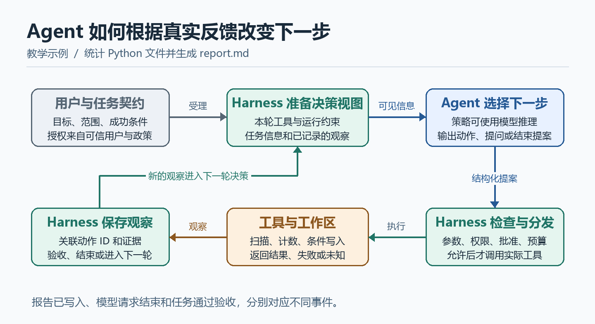

# Agent：目标驱动的决策循环与职责边界

## 摘要

本文讨论以大语言模型为主要推理能力的 Agent 系统，重点研究目标、观察、决策、执行和反馈如何组成一个可工作的闭环。全文采用两个明确的分析口径。系统层面的 Agent 是具有目标并与环境持续交互的执行体，模块层面的 Agent 决策策略则是这个系统中选择下一步的部分。Harness 承载该策略的运行，负责把可见信息送入决策，把动作提案转成受控执行，再把结果送回下一轮。

这一区分解决一个工程上的重复归责问题。设计文档常把规划、工具、记忆、循环、权限和恢复都列为“Agent 的能力”，实现文档又把它们列为“Harness 的功能”。本文逐项说明这些能力在语义决策、运行机制和外部业务执行之间如何分工，并给出模块接口、状态模型、完整轨迹和教学伪代码。贯穿案例是统计 Python 文件并生成报告，巡检设备用于检验外部副作用的边界。

**本文性质为工程分析与教学架构。** 分层是本文采用的可实现设计，术语可能在其他框架中覆盖不同范围。示例数值和代码用于说明机制，未形成部署或性能实验结论。

## 1. 问题背景与引入 Agent 的理由

### 从回答问题到改变任务环境

假设用户要求“统计项目中的 Python 文件，找出最长的三个，并生成报告”。普通模型请求可以生成一份操作说明，也可以生成实现该任务的脚本。若输入中没有真实文件内容或统计结果，模型生成的文件数量缺少来自项目的观察。要交付真实报告，系统必须建立对环境的访问路径，包括读取目录、执行统计、保存文件和核对结果。

接入工具解决了访问能力的问题。应用可以把工具名称、功能描述与参数结构送给模型，模型提出调用请求，应用执行后取回数据。可是第一次工具执行未必结束整个任务。目录可能没有 Python 文件，“最长”可能指字节数或行数，部分文件可能无法解码，报告路径可能已经存在。下一步是否继续、如何改用其他证据、何时询问用户，需要结合当前任务解释这些结果。

于是任务被分解成连续的决策问题。每一步先获得有限信息，再采取一个行动，随后环境暴露更多信息。Agent 系统负责组织这种按目标推进的交互。它的价值来自对具体观察作出适当响应，而工具函数负责完成明确的计算与操作。

### 什么情况下值得把路径选择交给模型

对于口径固定、输入格式统一、异常分支清楚的文件统计，普通程序就能完成扫描、排序和写入。本文仍采用该例，是因为读者容易验证每一步发生了什么，适合辨认模块边界。实际引入模型策略的需求，来自用户可能改换目标、要求解释代码组织、追加不同指标，或者遇到需要语义判断的环境反馈。

可以把实现选择放在两个维度上考察。第一个维度是任务目标的变化程度，第二个是执行路径能否预先写清。目标与路径都稳定时，固定程序很合适。目标表达多样而执行步骤稳定时，可以用一次模型调用提取参数，再运行固定流程。目标和后续路线都依赖执行中才出现的信息时，循环中的模型决策才有更直接的作用。

这里没有“用了模型就必须再搭一个 Agent”的推论。模型调用的延迟、费用和误判都需要被任务收益覆盖。Agent 也可以嵌入固定工作流的局部，例如固定地接收工单、检查身份和提交记录，只把疑难问题分析交给动态决策节点。Anthropic 对工作流与 Agent 的区分强调预先规定的路径和模型动态决定路径的差异，这支持按控制权分析系统的方法。[Building effective agents](https://www.anthropic.com/research/building-effective-agents)

### 引入 Harness 的理由如何随之出现

一旦模型开始决定下一步，普通程序就要接受一种新的输入来源。模型可以给出不合法参数、重复请求、提前结束，或者误解工具反馈。工程必须保证，即使本次提案有问题，任务仍按照明确的执行规则推进或停止。

另外，循环会积累消息、产物、调用费用和外部状态。负责记账、调用、保存与恢复的代码可以从业务策略中抽出，形成 Harness。它为决策提供稳定的运行协议，也让工程人员能独立检查“动作选得是否合适”和“获准的动作是否正确运行”。这种分离是职责设计，最初可以只体现为同一个程序中的几个函数。

## 2. 定义 Agent 时必须同时说明对象与范围

### 系统定义与决策模块定义

在系统层面，本文定义 Agent 为在给定目标和约束下，利用观察选择行动、通过行动获得新观察，并据此继续推进的执行体。一个完整的 LLM Agent 应用至少要解决目标表达、决策策略、环境接口与运行控制四类问题。

在模块层面，本文把其中依据目标和历史选择下一步的组件称为 **Agent 策略**，后文的“狭义 Agent”与此同义。这是便于拆分工程的约定。目标和观察进入策略，策略输出一个行动提案、澄清问题、阻塞说明或结束提案。

LLM 是策略可调用的推理组件。策略还包括业务提示、动作类型、任务规则、必要的确定性分支以及输出解释。相同模型权重可以在不同任务契约和工具集合下支持不同 Agent。一个 Agent 也可以在理解需求、规划和审查时调用不同模型。由此，模型实例数量、角色名称数量与 Agent 数量不存在固定的一一对应关系。

### 自治、规划和反馈的准确含义

自治表示系统在授权范围内能够选择部分后续动作，其程度由任务设计决定。例如读取哪些文件可自主决定，覆盖已有报告由用户批准。授权范围、预算和工具集合共同限定了自治空间。

规划表示建立达到目标的候选步骤及其依赖。规划可以是一份显式列表，也可以只选择当前最有价值的下一步。小任务不必增加一个独立 Planner 模块。大任务的计划如果被保存，必须允许观察推翻其中的假设，例如“所有文件都能读取”被解码错误推翻。

反馈表示环境或检查器返回的信息会改变下一次决策的输入。把工具输出写进日志但不送入下一轮，不能为策略提供反馈。每轮重新生成一个计划，却没有读取上轮执行结果，也无法形成有效的闭环。工程上判断循环是否成立，应追踪观察到底怎样进入下一次调用。

### 系统边界决定一句话的含义

“Agent 有记忆”在系统层面可以成立，因为应用包含存储与检索服务。落实到模块时，应继续分解为谁提出值得保存的内容、谁审批写入、谁实际持久化、谁检索以及谁注入上下文。“Agent 执行工具”同样可以描述完整系统的行为，程序内部则存在提案、权限判断、分发和工具函数执行等环节。

因此，分析项目时先确认作者描述的是产品、系统、模块还是模型，再讨论职责归属。下文的比较表采用模块口径，以便对接实际接口。

## 3. 术语对照与系统边界

| 名称 | 本文采用的含义 | Python 报告任务中的例子 |
| --- | --- | --- |
| 广义 Agent 系统 | 能接收目标、操作环境并根据反馈推进任务的完整应用 | 命令入口、任务决策、模型、Harness、工具和交付界面组成的报告助手 |
| 狭义 Agent | 决策层。结合任务目标、当前观察和可用能力，产生下一步提案 | 看到统计结果后决定生成报告，看到覆盖冲突后请求确认 |
| LLM | 大语言模型。根据本次输入生成文本或结构化输出 | 理解“最长”可能指行数，或者生成工具调用参数 |
| Harness | 承载一次运行的框架。组织模型和工具调用、执行规则并记录结果 | 注入工作区范围，检查路径和授权，执行并记录写入 |
| Tool | 可以被程序调用、具有明确输入和输出的具体能力 | 在允许范围内统计 Python 文件，原子写入报告 |
| 环境 | 被观察或改变的外部系统 | 工作区文件、版本或文件摘要、权限和现有报告 |

后文单写 **Agent** 时采用狭义口径。不同框架可能把整个循环、工具分发和存储都封装在一个 `Agent.run()` 或名为 `agent.py` 的模块里。判断职责时看实际输入、输出和授权主体，文件名和 API 名称提供的是代码定位线索。

**一次调用模型**会把输入变成文本或结构化输出。**一次工具调用**会把参数交给程序，得到外部观察或引起状态变化。**一次 Agent 运行**把这些步骤串成反馈回路，后续动作可由前面的结果改变。固定地“统计 → 渲染 → 保存”的程序也能做这个任务。增加 Agent 的理由是用户表达、环境反馈和异常路线足够多，事先很难用一套固定分支覆盖。具体计数仍适合交给确定性程序。固定工作流也可包含局部 Agent 决策，自治程度取决于系统把多少路径选择交给策略。

## 4. 工程分层与模块划分

### 任务域、决策、运行与外部执行

确定对象后，就可以从需求推导代码中的分工。本文采用四个责任面，它们允许同进程部署。

| 责任面 | 接收的输入 | 负责的处理 | 输出及权威范围 |
| --- | --- | --- | --- |
| 任务与领域规则 | 用户目标、身份、业务要求 | 定义统计口径、允许的部分交付、报告字段和验收要求 | TaskSpec 任务契约。业务语义由应用设计者与用户要求决定 |
| Agent 决策策略 | TaskSpec、可见观察、任务进度、可用能力 | 解释目标，决定取证顺序和后续行动，维护待解决问题 | Proposal 提案。其描述需要执行和验证后才能成为事实 |
| Harness 运行机制 | TaskSpec、Proposal、运行政策和执行事件 | 组织上下文，管理调用、权限、运行状态和结果回填 | RunState 运行记录及 Observation 观察。负责记录与执行控制 |
| 工具与领域系统 | 获准且校验过的动作参数 | 统计文件、保存报告，或操作设备和业务数据库 | 执行结果及外部状态。业务约束仍由对应服务实施 |

TaskSpec、Proposal、RunState 和 Observation 都是本文的数据类型名称，后文会说明字段。四个责任面并不构成一个只向下调用的线性链。Harness 驱动策略运行，策略可通过受管接口调用模型，工具结果又反向进入策略。架构分层描述模块职责，调用方向描述一次执行，两者需要分别阅读。

在这个布局中，LLM 作为推理依赖连接到策略或其他需要语义处理的组件。若 Harness 需要压缩历史，它也可以调用模型。模型调用所在的函数位置无法单独决定该功能的职责归属，应看这次调用要产生业务决策还是运行辅助信息。

### 如何拆出可以维护的代码

以下目录展示责任划分，文件名是教学建议。开发初期可以合并文件，保持接口即可。

```text
application/
  task_spec.py          用户目标、统计口径和验收要求
  report_rules.py       报告必须有哪些字段，如何判定部分完成
agent/
  policy.py             根据任务和观察选择下一步
  prompts.py            业务推理指引、动作说明和表达约定
  task_progress.py      已知事实、待确认假设和未满足的要求
runtime/
  runner.py             每轮调用、暂停、恢复和终态管理
  context.py            从运行记录构造本轮可见输入
  model_gateway.py      模型请求、取消、用量和结果适配
  dispatch.py           工具验证、授权、执行和反馈
  store.py              运行记录、动作与审批持久化
tools/
  scan_python.py        实际扫描与计数
  write_report.py       从统计证据生成并保存报告
```

一次需求变化可以检验拆分是否合理。把“前三个”改成“前五个”，主要改变任务参数、报告规则及相应工具参数。把 API 供应方换掉，主要改变模型适配。把覆盖改为必须批准，改变运行政策和审批交互。把运行恢复从内存改为数据库，改变状态存储实现。若每个变化都需要同时修改所有模块，就要检查是否把业务含义和运行机制纠缠在一起。

### 决策状态的归属与事实更新

Agent 的进度状态至少应区分已知事实、暂时假设、未完成要求和候选计划。已知事实附带观察引用，例如“11 个文件成功计数，依据 scan-17”。假设可以是“解码失败可能来自非 UTF-8 编码”，它引导取证，却不能直接提升为统计结论。未完成要求表示哪些目标仍缺证据。计划是下一步工作的候选顺序。

这些内容在语义上服务于决策，物理上可由 Harness 保存到数据库或消息历史。Agent 更新进度的接口不应允许它同时修改授权、实际工具终态和费用账本。保存到同一个 JSON 文档也应有字段级的写入规则。这样即使策略误判“写入已经成功”，运行时仍可依据真正的工具结果保持正确状态。

### 以接口约束建立可测试边界

策略的输入 DecisionView 只提供任务所需的信息。它包括目标、业务约束、观察列表、工具说明、当前进度和剩余预算提示。策略输出 Proposal，至少有动作种类、工具名和参数，或者澄清问题与证据引用。Harness 重新校验提案，分配动作 ID，记录尝试并产生 Observation。

观察应包含“调用了什么、发生了什么、证据在哪里”，例如 action_id、工具名、status、data 和 evidence_refs。失败原因要能支持下一步决策。“error”过于粗糙，至少需要区分参数错误、权限拒绝、确定失败和执行结果未知。原始错误细节可以单独存放，让模型只看脱敏后的必要信息。

这一接口使策略可以用预设观察单独测试。给出覆盖拒绝，检查策略是否改路线。给出部分扫描结果，检查最终提案是否保留缺口。执行器测试则固定恶意或错误提案，检查系统是否越权。两组测试分别定位决策质量与运行机制。


## 5. 从用户目标到下一步动作

用户提供的是期望，程序需要一个可传递、可校验的**任务契约**。在本例中，用户和工作区规则已经明确以下条件。

| 契约字段 | 取值与语义 |
| --- | --- |
| 目标 | 统计工作区中符合范围的 `.py` 文件，列出按行数排序的前三个并生成报告 |
| 范围 | 当前授权工作区，跳过 `.git`、`.venv` 与符号链接 |
| 统计口径 | 按 UTF-8 解码后分行，空行和注释计入。行数相同时按相对路径排序，少于三项就列出实际项 |
| 异常口径 | 有读取失败时记录文件及原因。可交付部分结果，报告和最终状态都明确标为部分完成 |
| 产物和权限 | 输出 `report.md`。首次创建在本任务已授权范围内，覆盖已有文件须额外确认 |
| 完成条件 | 报告与一次可追溯的统计结果相符，并有写入后的校验记录 |

收到结构化输入时，程序可以直接解析字段和检查类型。收到长提示词时，接收请求、读取可信元数据、拼接上下文可以由程序完成。若目标或约束需要语义提取，可由 Harness 组织一次 LLM 调用，要求模型返回候选目标、要求和疑点，或由 Agent 在首次决策时分析原文。解析程序只能识别约定的结构，无法凭空理解自然语言的歧义。

例如，用户只说“最长文件”时，业务策略可以基于既定默认值提出“按行数”，或请求澄清。如果用户的原话和模型提取结果不一致，应回到原文。模型提取的“可写任意路径”之类字段没有授予权限的效力。运行边界来自受信任的用户授权、应用政策和工作区配置。

任务进入运行后，Agent 的决策可以拆成五种工作：

1. **理解目标和成功条件。** 把“生成报告”拆成获取真实统计、形成报告、确认文件落盘和回报结果，识别“前三个”的排序口径。
2. **规划与取证。** 决定先看什么，再用什么能力。例如先调用只读统计工具，再依据结果生成报告。小任务可以每步重算下一动作，较复杂任务可维护依赖计划。
3. **选择和构造动作。** 在 Harness 暴露的能力中选择工具，填写参数，必要时提出子任务、澄清问题或人工确认请求。工具请求本身只是提案。
4. **解释反馈和修订计划。** 区分“扫描完成”“扫描部分完成”“无权限”“文件发生冲突”等观察，决定是否交付部分成果、补充取证或走另一条合法路线。
5. **提出收尾。** 基于可引用的观察说明完成了哪些要求、哪些仍未知，并提出结束。运行时可根据验收规则拒绝证据不足的结束提案。

策略既可使用 LLM，也可包含确定性规则。例如当读取失败时，程序按契约自动标记部分完成。LLM 更适合解释用户意图、处理未预设的反馈和组织最终表达。无论策略如何实现，实际写入或发出命令都需要经过执行边界。

## 6. 决策看到的状态与系统实际知道的状态

要根据反馈决策，首先要区分“发生了什么”和“Agent 看到了什么”。环境里已经存在某个文件，是世界状态。工具按权限扫描后返回路径、行数和错误清单，是**观察**。模型本轮收到的目标、工具说明、观察摘要等内容，是**上下文**。即使模型已经看到旧的 `report.md` 状态，另一个进程也可能在执行前改动它。

| 对象 | Agent 如何使用 | 谁保存或裁决 |
| --- | --- | --- |
| 任务目标和业务约束 | 解释期望、排序优先级、提出澄清 | 原文、结构化任务契约和修订事件由应用或 Harness 管理 |
| 计划、假设和未决问题 | 维护任务进度，决定哪个假设需要证据 | Agent 产生语义内容，Harness 按运行的状态协议保存必要部分 |
| 工具结果与证据引用 | 根据成功、失败、拒绝或未知更新判断 | 工具报告实际观察，Harness 关联调用、验证结构并存储记录 |
| 权限、预算和取消信号 | 决策时参考剩余额度，选择可行的路线 | Harness 在执行点根据可信状态强制检查 |
| 跨任务记忆 | 建议召回项目约定或提出候选经验 | 记忆服务与治理流程负责作用域、留存和发布，Harness 控制载入与写入路径 |
| 模型上下文 | 接收筛选后的任务信息和反馈 | Harness 组织、裁剪与传入，Agent 可提出召回重点或辅助生成摘要 |

消息历史、当前上下文、恢复检查点和长期记忆可以相互引用，但用途不同。聊天历史记录发生过的交互，检查点服务于恢复执行，长期记忆服务于以后任务。即使都用同一种结构化数据保存，也要分别决定写入权限、有效期、检索范围和可信程度。

可以把一次决策抽象成：

$$a_t = \pi(g, o_{\le t}, b_t, u_t)$$

$g$ 是目标， $o_{\le t}$ 是截至第 $t$ 步的可用观察， $b_t$ 是 Agent 当前的假设或计划， $u_t$ 是本轮可见的能力和运行约束， $\pi$ 是决策策略， $a_t$ 是动作或结束提案。这是接口抽象。它不假设 Agent 能获取环境的全部状态，也不表示每一轮都由 LLM 完成。提案只有在 Harness 接受并实际分发后才可能改变环境。下一条观察可以来自执行器、权限检查器、用户或外部服务。



图 1。AI 生成示意图。蓝色区域是狭义 Agent 的决策，绿色区域是 Harness 的组织和治理。沿实线看动作提案如何到达工具，沿底部回路看实际结果怎样变成下一轮可用的观察。

## 7. 把一次模型调用展开到数据层

前面的职责现在可以对应到一次具体模型请求。用户的自然语言首先进入应用。应用可以保存原文、身份和工作区，而“最长”的含义仍需要任务规则、模型解释或用户补充。本文约定用户已明确按行数统计，从而把后续决策限定在扫描、写报告与收尾。

调用模型时，Agent 并不会把内存中的 Python 函数传给远端模型。Harness 将工具能力序列化为名称、用途和参数定义。模型只看见这份描述与上下文。以下是与供应方无关的教学表示。

```json
{
  "task": {
    "goal": "生成 Python 文件统计报告",
    "ranking": "line_count",
    "allow_partial": true
  },
  "observations": [],
  "tools": [
    {
      "name": "scan_python",
      "description": "按任务约定扫描获准工作区并返回统计证据",
      "parameters": {}
    },
    {
      "name": "write_report",
      "description": "依据已保存的统计证据生成 report.md",
      "parameters": {"scan_ref": "string"}
    }
  ]
}
```

模型可以据此提出 `{"kind":"tool","name":"scan_python","arguments":{}}`。Harness 解析该结构，从工具注册表查到真正的函数，绑定可信工作区和统计规则，才开始调用扫描实现。名称到函数的映射由程序建立，外部模型无需知道函数地址或访问凭据。

假设工具返回“12 个候选文件，11 个成功读取，1 个失败”。这里的 12 是范围内发现的文件数，11 是参与行数排名的文件数。只有成功读取的文件参与排名，因此前三名是“已成功统计文件中的前三名”。未读取的文件可能更长，报告必须保留这一局限。这样的语义区别应由工具结果结构、业务验收和 Agent 表达共同维护。

下一轮请求保留目标，加入扫描观察及 scan-17 引用。模型才有依据请求写入报告。若 Harness 使用消息式模型 API，还需保持模型工具请求与工具结果之间的关联，按所用协议保留调用标识和必要消息顺序。截断大输出时保留统计摘要、错误数量和证据引用，否则决策会遗漏刚出现的事实。

工具结果进入上下文会改变本轮输入，并不修改模型权重。长期记忆的检索同理。模型服务是否缓存计算、是否存储会话，是供应方与应用配置的问题，系统仍应通过明确的输入和持久化协议保证可恢复性。


## 8. 把一份报告的执行轨迹拆开

下面是一条假设轨迹。行数、路径和返回值仅用于说明数据如何传递。

| 时点 | Agent 提出的下一步 | Harness 与工具实际做的事 | 回到下一轮的观察 |
| --- | --- | --- | --- |
| 建立任务 | 如有歧义先澄清，否则先统计 | 从授权工作区建立任务契约，准备工具说明并调用策略 | 目标、统计口径和允许的能力 |
| 第一次决策 | `ToolCall("scan_python", {})` | Harness 绑定工作区和范围。扫描工具枚举、解码和计数 | 结果 `scan-17`，12 个候选，11 个成功统计，1 个解码失败。前三名带路径与行数 |
| 第二次决策 | `ToolCall("write_report", {scan_ref: "scan-17"})` | 检查统计引用属于本次运行。发现已有 `report.md`，持久化待批准动作，不执行覆盖 | `waiting_approval`，说明目标、证据及覆盖范围 |
| 用户批准后 | 恢复原提案 | Harness 校验批准绑定的动作及文件版本，再用统计结果渲染并写入，读回校验 | 写入证据 `write-21`，报告反映 11 项成功和 1 项未知 |
| 收尾 | `Finish([ "scan-17", "write-21" ])` | 核对统计引用、报告内容、写入证据和已知缺口 | `completed_partial`，用户看到报告路径、统计范围和解码缺口 |

如果用户拒绝覆盖，Harness 记录拒绝并把它作为观察。Agent 可以报告已有统计及阻塞点，或在用户授权允许时请求采用别的路径。如果批准后原文件又被修改，运行时以冲突处理，旧批准不会自动适用于新版本。如果解码失败且任务契约要求完整统计，则同一批观察只能支持未完成或继续取证。

这条轨迹回答了“谁在调用模型”的两个层次：

- **决策归属。** 理解目标、提出动作和解释结果是 Agent 策略的工作，因此常说“Agent 用模型做决策”。
- **程序调用链。** 本文把模型 API 的网络调用放在 Harness 的 Provider 适配器里。Agent 通过注入的接口发起推理请求，适配器选定配置、发送请求并记录用量。框架也可由 Runner 先调模型再把候选动作交给策略判断。
- **执行归属。** 模型返回工具名和参数。Harness 解析、鉴权和分发。扫描脚本或文件服务真正读写文件。工具在 MCP Server 或远端服务时，进程间通信仍是执行链的一部分。

Agent 也可以发起“请用户确认”的决策，Harness 则保存待确认动作并核验回复。如果动作触发硬性审批规则，即使 Agent 没有发起确认，Harness 仍须拦截。

## 9. 决策层伪代码与最小闭环

使用一个窄接口，把模型所做的事和程序能执行的事分开。`ToolCall` 携带工具名和参数，运行时分配动作 ID。`Ask` 携带待澄清的问题，`Finish` 携带证据引用，`Blocked` 携带阻塞原因。工具观察包含调用 ID、状态、数据摘要和证据引用。`view` 是 Harness 提供给 Agent 的只读决策视图，`llm` 是受管的模型调用接口。

```python
# 教学伪代码。这里描述的是 Agent 决策接口。
def decide(view, llm):
    if view.missing_required_meaning:
        return Ask(view.clarification_question)

    # 即使原计划希望覆盖，用户拒绝后也要更新路线。
    if view.last_observation.is_denied("write_report"):
        return Blocked("已有报告未获覆盖授权", view.scan_evidence)

    if view.last_observation.is_unknown("write_report"):
        return ToolCall("inspect_report", {"scan_ref": view.scan_ref})

    if view.last_observation.is_conflict("write_report"):
        return Blocked("批准所绑定的文件版本已变化", view.scan_evidence)

    # 模型可在当前观察基础上选择工具、提问或提交结束提案。
    return llm.propose(
        goal=view.goal,
        constraints=view.task_constraints,
        observations=view.observations,
        open_questions=view.open_questions,
        allowed_action_schemas=view.action_schemas,
    )
```

一次典型的 `llm.propose` 先返回 `scan_python`，看到可引用的统计结果后才返回 `write_report`。若文件写入结果不确定，`inspect_report` 只读核查报告与运行记录，核查后仍缺证据时应保留未知或阻塞状态。这里只用显式规则演示敏感反馈如何改变路线。生产实现还需要模型输出校验、任务隔离和重启恢复，详见 [[Harness：运行时架构、执行治理与职责边界|Harness 的运行控制与伪代码]]。

最短闭环可以只实现三个接口。`decide(view)` 提出动作，`dispatch(call)` 经过检查后执行并返回观察，`record(observation)` 让下次决策看见结果。计划、模型和工具分发可以在同一线程和进程中运行。只要接口职责清楚，就能分别测试：给定拒绝观察，策略是否避免重复提交同一写入；给定越权提案，分发器是否阻止实际副作用。

## 10. 循环的限制因素与终止设计

### 为什么完成判断之外还需要硬性限制

Agent 根据观察判断是否继续，但任务可能一直没有成功证据。工具持续返回同一错误、模型反复提出相同计划、目标含糊而用户迟迟不补充，都可能让运行无限延长。因此每次运行需要同时具备目标导向的结束规则和资源导向的停止规则。前者判断任务是否完成，后者规定在什么条件下必须停下或等待。

最大循环次数属于 Agent 循环契约。设计策略时应确定它的含义，并让策略知道剩余机会。实际计数和强制停止由承载循环的代码实施。如果代码封装在 Agent 类里，这段代码同样承担循环执行控制职责。把“最多执行 10 轮”写进提示词，只提供行为指引；计数器和执行前判断才决定第 11 轮是否真的开始。

### 先定义一轮，才能设置最大循环次数

本文定义一轮决策为“从当前观察构造一次决策输入，并要求策略产生一个下一步提案”。某轮可能只提问，也可能输出工具动作或结束提案。一次工具动作还可能包含多次底层网络尝试。外层验收要求再做一轮任务，也可能开启多个决策轮。

模型输出格式不合法仍消耗已经发生的决策轮。模型调用失败的费用与调用次数也要记账。等待用户回复不应该不断空转消耗决策轮，系统应保存等待状态，收到有效回复后再继续。若框架将每次模型调用都算一轮，或允许一轮提出多项工具动作，应在配置文档中明确采用的口径。

例如设置最大决策轮数为 12，已完成 11 轮，第 12 轮可以提出收尾或进行一次必要取证。第 12 轮结束仍没有足够证据时，记录“达到决策轮数上限”，并交付已确认结果。停止原因和任务完成程度分别保存，达到上限并不会自动满足验收条件。

### 需要考虑哪些上限

以下数值只用于演示不同限制的作用，实际阈值应由任务时长、风险、工具代价和评测结果确定。

| 限制 | 计量对象 | 教学配置 | 触发后的处理 |
| --- | --- | --- | --- |
| 最大决策轮数 | 本次运行已开始的策略决策轮 | 12 轮 | 停止新决策，输出已确认结果和未完成要求 |
| 连续无进展轮数 | 连续未获得新证据、未消除缺口的轮数 | 3 轮 | 改变路线、请求澄清，或以无进展原因结束 |
| 最大重规划次数 | 实质性替换当前计划的次数 | 3 次 | 保留现有证据，说明障碍并请求用户介入 |
| 同一失败动作的重复提案数 | 同一目标与规范化参数下的重复提案 | 2 次 | 阻止反复撞同一障碍，将失败反馈加入下一轮 |
| 最大澄清轮数 | 向用户提出并处理任务澄清的次数 | 3 轮 | 请求一次完整补充，或保存为待用户处理 |
| 外层验收修订次数 | 完成一版产物后因验收缺口重新工作的次数 | 2 次 | 给出当前产物和仍未满足的验收项 |
| 整体任务截止时间 | 从任务开始到截止时刻的时间 | 5 分钟 | 停止新动作，记录截止及未确认的在途结果 |
| 推理资源预算 | 模型调用费用、输入输出 token 与允许模型 | 由应用给定 | 提前缩小分析范围或收尾，达到上限后停止 |
| 子任务深度与数量 | 委托链的深度和已创建子任务数 | 深度 2、总数 4 | 在现有任务范围内解决，或报告分解受限 |

“进展”需要有可检查的定义。报告任务可以用新增有效扫描证据、解决一个编码问题、完成获准写入、满足一个验收项作为进展。模型换一种说法重写计划，或重复声称即将完成，不应直接重置无进展计数。对开放研究任务，进展评价更难，可以结合新增来源、问题覆盖和人工评审，并承认评价存在不确定性。

“同一失败动作”也需要身份定义。参数空格不同但目标相同，应视为同类提案。用户给出新授权或环境发生有证据的变化后，再次尝试可能合理，应作为有新前提的动作记录，而非永久禁用该能力。

### 多种限制怎样同时工作

最大轮数约束决策次数，任务截止时间约束总等待与执行时间，费用约束推理资源。三者共同生效。即使尚有 8 轮机会，截止时间到达仍应停止；即使费用充足，同一操作持续无进展也应进入阻塞或澄清路径。

更精细的设计会给收尾保留资源。例如在 12 轮上限下，剩余 2 轮时给策略发送接近上限的观察，让它优先验证当前产物并整理缺口。预留资源只是改善收尾质量，最终硬上限仍应在每轮开始前检查。工具调用总数和实际重试次数属于运行执行计数，策略接收它们的剩余额度，以免制定已经无法执行的计划。

### 如何表达终态

| 结束或暂停状态 | 含义 | 证据要求 |
| --- | --- | --- |
| 已完成 | 当前任务契约中的必要要求全部满足 | 每项要求有相应的检查结果 |
| 部分完成 | 用户允许部分交付，已有成果同时存在明确缺口 | 成果、缺口和适用范围都可追溯 |
| 等待输入 | 必要语义或参数缺失 | 保存具体问题和续作所需信息 |
| 等待批准 | 某个明确动作需要授权 | 保存动作、参数与授权范围 |
| 阻塞 | 在现有能力和约束下无法继续 | 记录导致阻塞的观察及已尝试路线 |
| 达到上限 | 次数、时长或费用限额已触发 | 记录具体计数、阈值和未完成项 |
| 已取消 | 收到可信取消请求 | 记录取消来源及仍未确认的在途动作 |
| 结果未知 | 外部动作可能已发生，缺少可靠结果 | 保留请求身份与待核查事项 |

一个运行记录可同时包含完成程度和停止原因。例如“部分报告已生成，因轮数耗尽结束”，比只写“完成”保留了更准确的状态。Agent 面向用户的表达应读取这两部分，确保语言与执行证据一致。

### 带限制的决策循环伪代码

下面补全循环层的最小语义。`agent.step` 产生下一步提案，`port.resolve` 通过受管接口取得观察，可能因工具执行、用户补充或运行限制而返回不同结果。此处展示 Agent 循环如何消费限制信号，接口内部的工具调用计数在 Harness 篇展开。

```python
def run_agent(task, agent, port, limits):
    progress = TaskProgress(task)
    rounds = 0
    stagnant_rounds = 0

    while rounds < limits.max_decision_rounds:
        if port.cancelled():
            return Stop("cancelled", progress)
        if port.deadline_reached():
            return Stop("deadline", progress)

        rounds += 1
        proposal = agent.step(
            task=task,
            progress=progress,
            remaining_rounds=limits.max_decision_rounds - rounds,
        )

        if proposal.kind == "ask":
            return Suspend("waiting_input", proposal, progress, rounds)

        if proposal.kind == "finish":
            observation = port.verify(proposal, task)
            if observation.requirements_satisfied:
                return Stop("completed", progress, observation)
            if observation.partial_accepted:
                return Stop("completed_partial", progress, observation)
        else:
            observation = port.resolve(proposal)
            if observation.waiting:
                return Suspend(observation.status, proposal, progress, rounds)

        changed = progress.apply_evidence(observation)
        stagnant_rounds = 0 if changed else stagnant_rounds + 1
        if observation.hard_limit_reached:
            return Stop(observation.stop_reason, progress)
        if stagnant_rounds >= limits.max_stagnant_rounds:
            return Stop("no_progress", progress)

    return Stop("decision_round_limit", progress)
```

`TaskProgress` 保存已有证据、缺口和当前计划，`Stop` 保存停止原因与交付信息，`Suspend` 保存恢复位置。恢复时必须读取已消耗的轮数和无进展计数，不能重新归零。此段只展开总轮数和无进展限制，重规划、重复提案、澄清与子任务计数按上表采用各自持久化计数器。生产实现还需把异常输出转成观察，并持久化每次计数变化。

## 11. 选工具、加载 Skill 与委托子 Agent

决策层提出动作时，有几种形态容易混在一起。

- **Tool** 是具体能力。`scan_python` 接收参数并返回结构化统计。Agent 依据描述选择它，Harness 依权限分发，工具实现负责正确计数。
- **MCP** 是模型上下文协议，为宿主连接并调用外部能力提供标准接口。Agent 可以提出一个由 MCP 暴露的工具调用，宿主通过 MCP Client 把请求传给 Server。是否授权、如何限制副作用、如何消费反馈依然由相应组件负责。见 [[MCP 原理、调用链与最小实现|MCP 的 Host、Client 和 Server]]。
- **Skill** 是可复用的程序性知识，例如“生成文件统计报告时要记录统计范围和失败项”。Agent 可以根据任务选用。Harness 可以按规则发现、加载和提供内容。文本规则能够指导决策，真正的覆盖限制仍由执行门禁实现。见 [[Agent Skill：可复用的程序性知识与工程化运行机制|Skill 的发现与执行边界]]。
- **子 Agent** 有局部目标、状态和自己的决策反馈回路。父 Agent 可提出委托，例如让子 Agent 检查报告是否遗漏统计口径。Harness 负责创建受限运行、分配预算、传递上下文并关联结果。子 Agent 的输出也是观察，需要按证据评估。

是否要先用外层 LLM 判断“该找哪个 Agent”，取决于入口场景。可以通过 UI 直接选角色，可以按确定性规则路由，也可以让模型给出候选。路由决定工作交给谁，任务策略决定接手后怎样推进。只有一套决策策略和一条执行循环的系统，不需要额外路由模型。多 Agent 系统还要明确子任务输入、产物交接、并发写入约束与取消传播。

## 12. 内层动作循环和外层验收循环

`scan → write → finish` 描述的是动作循环。Agent 选择下一动作，Harness 获取并回填观察，再进入新一轮。较复杂的任务可以增加一个外层循环，检查一轮工作是否满足完整验收条件。例如外层发现报告漏掉失败的文件，便把这一缺口交回内层修改。

- **动作层**处理下一步选择，例如再扫描一次，或读取已有报告。
- **验收层**判断产物和目标是否匹配，可以组合确定性检查、独立模型评审和人工验收。
- **运行层**对两层施加预算、次数、截止时间与取消规则。预算耗尽后可交付已确认结果并标明终止原因。

所谓 **Loop Engineering** 在这里指怎样组织观察、路由、行动、反馈、验收和终止。循环代码可能由 Harness 执行，里面的决策节点仍由 Agent 策略负责。重新发出相同请求只有在失败可恢复、预算允许且副作用可以安全控制时才有意义。对于能从反馈中判断原因的任务，修订计划和机械重试是两件事。更细的状态和路由见 [[循环图工程：从状态演化到反馈控制|循环图工程]]。

## 13. 用巡检任务检查边界能否迁移

假设用户说“让机器狗 A 检查东区，结束后告诉我结果”。在只负责对话与设备交互的巡检 Agent 设计中，Agent 可追问缺失参数、提出查询设备状态或下发任务，并解释回执。Harness 或通信适配器负责查找连接、鉴权、关联 `requestId` 与回包、计时和记账。设备负责地图、导航与实际巡检，并拥有实际任务状态。

设备“已接收”仅确认接收请求。设备返回最终结果，或通过权威查询取得明确状态，才能支撑对应的完成报告。若发送后断线，Agent 可汇报“执行状态未知”并尝试查询，但不能靠上下文补出物理世界的事实。连接重建也不会自动证明先前请求是否执行。这个边界和文件写入超时相同：**Agent 选择如何查证，Harness 传递可查证的事实，实际状态由环境或业务系统提供。**

## 14. 资料、适用范围与复习

本文把曾分别讨论的任务路由、Agent Loop、工具反馈、Skill、记忆和验收，合在同一套教学接口中。多数决策步骤由模型产生候选动作，Runner 驱动外层循环。这是便于讲解的一种布局。事件驱动、固定图、Agent 自持循环以及托管式工具运行也可实现同样的责任分工。仅凭模型回答、验收摘要或单次成功轨迹，无法判断长期可靠性。

- 天枢是曾拆解过的实现对照。可以沿固定提交阅读任务契约、工具反馈和验收机制，观察真实项目怎样把部分职责放在一个执行模块中。本文伪代码使用自己的接口。[天枢任务数据模型](https://github.com/MJ-CJM/tianshu/blob/88462b2a6e46ae750e07697877613b9820bb5103/src/tianshu/models/edict.py) · [天枢 Agent 执行器](https://github.com/MJ-CJM/tianshu/blob/88462b2a6e46ae750e07697877613b9820bb5103/src/tianshu/executor/agent.py) · [天枢外层验收循环](https://github.com/MJ-CJM/tianshu/blob/88462b2a6e46ae750e07697877613b9820bb5103/src/tianshu/executor/orchestrator/loop.py)
- 想进一步区分“本轮修订计划”和“跨任务持续改进”，可以对照 [[Agent 自我迭代：从技能优化到模型与环境协同进化|Agent 自我迭代]]，沿着候选改动、评估、批准和生效版本追踪它改了什么。

复习时可以按四条记录读一次运行。先看用户授权了什么，再看 Agent 提议了什么、执行器实际做了什么、最后拿到什么证据。只要这四条能分别说清楚，就能判断一次失败出在目标理解、决策、运行控制、工具实现还是环境本身。
