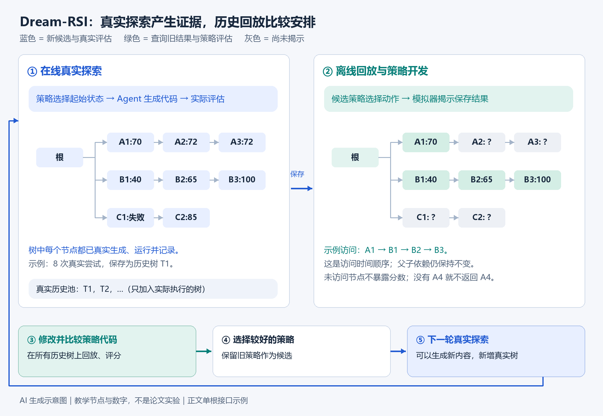

# Dream-RSI：从历史回放到探索策略自我改进

## 从优化答案，到优化寻找答案的方式

让一个编程 Agent 修改程序并不难描述：生成一个版本，运行测试，根据反馈再修改。但当任务需要数百次尝试时，另一个问题会变得重要：应该把预算投入哪个方向，哪些尝试可以并行，什么时候停止继续优化？即使每次修改都由能力很强的模型完成，错误的资源分配仍可能让大量计算没有产出。

Dream-RSI 研究的就是这一层问题。其完整名称为 **Dream-RSI: Recursive Self-Improvement through Evolving Worlds**，可以理解为“通过不断扩大的回放世界，实现探索策略的递归自我改进”。它将真实探索留下的历史整理成可回放环境，用来低成本比较不同的探索策略，再把较好的策略投入下一轮真实探索。

本文以 **2026 年 10 月 6 日更新的论文 v2** 为依据，沿“问题 → 角色 → 真实探索 → 历史回放 → 评分手算 → 递归更新 → 实验与边界”的路线展开。贯穿示例是代码优化任务；所有 A1、B2 等节点、示例分数和手算数字均为教学假设，不是论文实验。文中标为“机制分析”或“扩展设计”的内容，不代表作者已经实现或验证。

读完本文，应能区分：哪些结果来自真实执行，哪些动作只是回放；策略可以改变什么；历史中没有 A4 时为什么不能在回放中得到 A4；评分中的质量、成本和并行分别怎样计算。

## 1. 三个角色与两种改进对象

理解方法前，先分开系统中的职责。

| 角色 | 输入与工作 | 输出 |
|---|---|---|
| 基础 Agent | 读取当前程序、任务和可用历史，提出并实现一次修改 | 候选程序或方案 |
| 评估器 | 按固定协议检查候选的正确性与性能 | 分数、失败信息等反馈 |
| 探索策略 | 根据已经获得的反馈安排下一批尝试 | 继续哪些分支、是否开启新分支、是否停止 |

**任务解法**是要优化的程序、算法或 Agent 运行框架。**探索策略**是安排这些优化尝试的可执行程序。前者决定“采用什么解法”，后者决定“把下一批资源投入哪里”。

Dream-RSI 的递归更新针对探索策略代码；底层模型、评估器和执行接口在方法循环中保持固定。固定模型仍然能够生成新程序，也能修改策略代码，但这不等于模型参数通过训练发生了变化。[1，第 3 节]

这里的“策略”可以理解成函数：

$$\pi:(\text{已观察的探索状态},\text{预算偏好})\longmapsto\text{下一批探索动作}$$

例如，策略输出“继续 A 分支、继续 B 分支”；随后两个基础 Agent 尝试才分别产生新代码并接受评估。策略不是直接输出两段优化代码。

## 2. 为什么探索策略难以优化

评估一个候选程序，通常只需要执行一次评估协议。评估一种探索策略，则需要观察它安排一系列尝试之后的整体表现。

如果一种策略总是继续当前得分最高的版本，它可能快速获得小幅提升，也可能被收益逐渐停滞的方向吸引。另一种策略为新方向保留预算，可能发现结构性突破，也可能浪费更多尝试。只有得到足够长的探索轨迹，才能比较这两种安排。

因此，策略层的反馈具有两个特点：**反馈延迟**，因为价值需要经过多步尝试才显现；**反馈昂贵**，因为比较每个策略都可能要求重新生成并执行大量候选。[2，方法介绍]

Dream-RSI 的切入点是：过去的真实尝试已经付过生成和评估成本，只要其依赖关系与结果被完整保存，就可以用来评估别的资源分配方式。它把静态历史转换成可反复查询的实验环境。



*图 1：AI 生成示意图。左侧真实探索产生候选、实际评估和历史树；右侧回放只揭示保存结果，用于修改和比较策略。新增真实历史来自下一轮在线探索，而不是回放。图中节点与颜色用于解释机制，不是论文原图或实验结果。*

## 3. 探索树记录的是状态依赖

设根节点为初始工作状态。一个非根节点表示一次已经完成的尝试，记录其父节点、生成历史、工作空间快照和评估分数等信息。父节点表示这次尝试从哪个保存状态开始。[1，第 3 节]

例如：

```text
初始代码（根）
├─ A1 → A2 → A3
├─ B1 → B2 → B3
└─ C1 → C2
```

A2 从 A1 的状态继续生成；B2 从 B1 的状态继续生成。因此，“先执行 A1，后执行 B2”不意味着 B2 的父节点变成了 A1。

必须区分两种顺序：

- **状态依赖顺序**：哪个保存状态用于生成这个候选，例如 B1 → B2。
- **时间调度顺序**：先探索哪个分支、后探索哪个分支，以及哪些尝试同批执行。

历史回放主要改变第二种顺序，同时保留第一种依赖。

### 3.1 叶节点是随执行进展变化的身份

| 当前分支状态 | 当前叶节点 | 已成为内部节点的尝试 |
|---|---|---|
| 根 → A1 | A1 | 无 |
| 根 → A1 → A2 | A2 | A1 |
| 根 → A1 → A2 → A3 | A3 | A1、A2 |

A1、A2、A3 都是节点，但不会始终都是叶节点。正文的可选集合为根和当前叶节点：

$$A(\mathcal T)=\{r\}\cup\{v\in\mathcal T:v\text{ 是叶节点}\}$$

这里 $\mathcal T$ 是当前可见树， $r$ 是根节点。若最多有 $W$ 个并行工作位，动作是其中一个大小不超过 $W$ 的集合 $C$ 。选择根用于开启新分支，选择叶节点用于继续现有分支，空集合用于停止。[1，第 3 节]

按这个正文集合定义，根在一批中最多出现一次；两个工作位并不自动表示可把同一个根选择两次。附录 D.2 的实现提示词允许一批包含多个合法 root 动作，粒度与正文的单根集合表达不同。本文教学表按正文接口组织，不据此推断完整实现；不能把“正文动作集合”与“附录可操作单元”混为一个未经核对的接口。

### 3.2 内部节点不能直接重新分支

当已经走到 A3 时，正文策略接口不能直接选择 A1，开启 A1 → A2′ → A3′。这是一项动作限制，不是“旧代码不能撤销”。

仍然符合该接口的处理包括：从 A3 继续，让下一次候选撤销一些改动并采用新方法；或从根开启新方向。前一种情况即使代码接近 A1，树上的父子关系仍为 A3 → A4，因为尝试从 A3 启动。它是否成功，需要真实执行评估，不能根据意图认定。

如果希望恢复任意历史节点并另开分支，可以扩展调度器。**这是扩展设计**：需要同步修改动作集合、多后继记录、状态恢复及回放规则，不能视为原方法已经具备。没有被真实生成和评估的 A2′，不会因为接口扩展就拥有可回放分数。

## 4. 第一轮真实探索如何形成历史

以下是教学任务：从同一初始代码出发，尝试不同优化方向，有两个工作位。初始策略可以实际安排如下五批实验。

| 真实执行批次 | 选择的起始状态 | 真正生成并评估的候选 |
|---|---|---|
| 1 | 根 | A1 |
| 2 | A1、根 | A2、B1 |
| 3 | A2、B1 | A3、B2 |
| 4 | B2、根 | B3、C1 |
| 5 | C1 | C2 |

这里三条分支都在真实探索中形成。再次选择根，分别开启了 B、C 两条路线；选择叶节点则继续原路线。总共真实执行八次尝试，才得到上一节的树。分支不必是完全不同的算法，也可以是不同实现或修复路线。

设测得如下教学结果，数值越高越好：

```text
根
├─ A1：70 → A2：72 → A3：72
├─ B1：40 → B2：65 → B3：100
└─ C1：实现失败 → C2：85
```

这段历史提示三种不同情况：A 的收益趋于停滞；B 起点较弱但后续改善；C 的实现失败没有证明整个方向没有价值。策略可以利用这类差异安排预算，但在某个节点出现之前不能提前知道其结果。

**此时全部节点都来自真实生成与实际评估，还没有发生离线回放。** 这一轮停止后，将完整树记录为 $\mathcal T_1$ ，放入历史回放池。

Dream-RSI 不要求先有一个由外部人员完全做完的任务。它自己先开展真实探索，再利用自己产生的历史改进下一轮安排。“完成一轮探索”也不等于任务已经达到全局最优。

## 5. 离线回放怎样使用同一棵历史树

真实探索结束后，模拟器拥有完整历史，但一次策略回放从根开始，只逐步向策略揭示它选择访问的结果。

下面假设候选策略 Q 决定较早放弃继续 A，并尝试 B。每一步只根据此前可见结果作决定：

| 回放批次 | 策略选择 | 模拟器揭示的旧结果 |
|---|---|---|
| 1 | 根 | A1 的记录：70 |
| 2 | 根 | B1 的记录：40 |
| 3 | B1 | B2 的记录：65 |
| 4 | B2 | B3 的记录：100 |
| 结束 | 空动作 | 停止并统计评分 |

这次回放没有重新生成或运行 A1、B1、B2、B3，只读取了它们保存的结果。它的模拟尝试计数为四，表示这种安排在记录空间中消耗四次尝试预算，而不是这次回放重新付费执行四个候选。

### 5.1 前缀可见约束

在 B1 出现时，策略只能知道 B1 的已揭示结果，不能看到 B3 的 100，然后据此决定继续 B。否则得到的是记住答案的程序，而不是能够部署的探索策略。这种信息约束称为 prefix-only，即前缀可见。[1，附录 D.2]

开发策略的 Agent 可以分析已经收集的历史失败案例；被评估的策略在每次动作时仍必须遵守前缀边界。二者并不矛盾：前者类似用训练案例开发算法，后者类似算法运行时不能读取未揭示答案。但针对同一批历史反复修改策略，仍可能过拟合。

### 5.2 回放并非任意重排或拼接

按正文规则，开启新分支时，揭示根节点下按创建时间排序的下一个未打开分支。若历史顺序为 A、B、C，就不能从 A1 直接跳过 B，打开 C1。分支内部也必须依次揭示，不能跳过 B1 直接访问 B2。[1，第 3 节]

因此，回放允许变化的是：何时开下一个分支、继续哪条已打开分支、继续多深、哪些合法动作并行、何时停止。它既不把 B2 接成 A1 的子节点，也不把 A1、B2、C2 拼成一段从未执行过的新解法。

### 5.3 历史中没有 A4，就不能在回放中得到 A4

若真实记录只到 A3，回放不会自行生成 A4，不会推测 A4 分数来参与评估，也不会将这种推测加入历史池。它可以帮助开发出更愿意继续某类分支的策略；但新增候选必须在随后在线探索中实际生成并评估。

| 阶段 | 能产生的新内容 |
|---|---|
| 离线策略开发 | 新的探索策略代码 |
| 历史回放 | 新的策略访问轨迹、预算统计与评分记录 |
| 在线真实探索 | 新的任务候选、实际评估结果和真实历史树 |

**Dream-RSI 整体能够发现新内容；历史回放阶段不能发现未记录的任务结果。**

## 6. 质量与成本评分：手算策略效率

仅比较最后最高分，会鼓励策略把历史全部看完；仅比较尝试次数，又可能鼓励什么都不做。评分需要同时考虑获得了多少质量和付出多少尝试。

先固定一个策略版本和一棵历史树，省略对应下标。定义：

| 符号 | 含义 |
|---|---|
| $B$ | 整棵历史树的非根节点总数，即历史真实尝试数 |
| $S$ | 这棵历史树中的最高记录分数，假设为正 |
| $n_\rho$ | 策略在预算偏好设置下揭示的尝试数 |
| $s_\rho$ | 这些已揭示尝试中的最高分 |
| $a_\rho$ | 相对于历史最佳结果的归一化质量 |

$$a_\rho=\mathrm{clip}(s_\rho/S,0,1)$$

无尝试时，将其质量设为零。预算偏好参数集合为 $\mathcal R=\{0,0.25,0.5,0.75,1\}$ 。这些参数控制策略对预算的偏好，不等于必然使用总预算对应比例。[1，第 3 节]

同一策略在不同设置下产生若干质量—成本点。如果一个点成本不低、质量不高，且至少一项更差，就被另一个点支配，应从前沿移除。剩下的不同点按尝试数递增排列为 $ (\bar n_j,\bar a_j) $ ，共有 $L$ 个，令 $\bar a_0=0$ 。

质量与成本部分为：

$$H=\frac{1}{B}\sum_{j=1}^{L}(\bar a_j-\bar a_{j-1})(B-\bar n_j)$$

这是论文归一化 hypervolume 项的简写，表示质量—成本 Pareto 前沿对应的面积。每次质量增量乘以剩余预算空间，因此同样的质量提升，用更少尝试获得，会得到更大贡献。[1，公式 1]

### 6.1 质量与成本的独立教学数据

这一手算例子与前面的八节点树独立，不将不同教学数据混用。假设历史共有十次尝试、最高分 100，一个策略在不同预算设置下的三个不被支配点为：

| 尝试数 | 最高分 | 归一化质量 |
|---:|---:|---:|
| 2 | 60 | 0.6 |
| 5 | 90 | 0.9 |
| 8 | 100 | 1.0 |

$$H=\frac{0.6(10-2)+(0.9-0.6)(10-5)+(1-0.9)(10-8)}{10}=0.65$$

前 60% 的历史相对质量只花两次获得，因此贡献较大；后续 30% 花五次获得；最后 10% 到第八次才获得，贡献较小。

另一个策略若得到点 $ (4,0.6),(7,0.9),(10,1.0) $ ，则：

$$H'=\frac{0.6(10-4)+0.3(10-7)+0.1(10-10)}{10}=0.45$$

二者都能找到这段历史中的最好结果，但前者更有效率。最后一次才获得的质量增量，其面积贡献为零，体现的是“相对于完整历史预算，越早达到越有价值”的目标偏好。

归一化质量为 1 只表示达到该历史中的最好分数，不能证明达到任务全局最优。分数比值也未必具有“完成了任务百分之多少”的语义。

## 7. 并行评分：尝试数与顺序轮次不是同一个量

总尝试数反映执行了多少候选；顺序轮次反映这些候选需要分多少批才能完成。并行不会把四次尝试算成一次。

### 7.1 独立尝试可以同批，父子尝试不能同批

假设 A1、B1 已经得到，接下来需要 A2、A3、B2、B3 四次尝试：

| 后续轮次 | 串行安排 | 两工作位并行安排 |
|---|---|---|
| 1 | A2 | A2、B2 |
| 2 | A3 | A3、B3 |
| 3 | B2 | 已完成 |
| 4 | B3 | 已完成 |

并行安排仍然做四次尝试，只需要两轮。A2 和 B2 依赖不同的已存在状态，可以同批；A2 和 A3 不能同批，因为 A3 要等待 A2 的工作状态生成。

这一表仅比较后续片段；正式回放评分统计完整运行，包括开分支等前序成本。

### 7.2 并行惩罚从哪里来

令 $k_\rho$ 为某预算偏好下完成的顺序决策轮次， $n_\rho$ 为总尝试数。正文批次不超过工作位数，因此每个合法非空批次记一轮。

$$P=\frac{1}{\#\mathcal R}\sum_{\rho\in\mathcal R,\ n_\rho>0}\frac{k_\rho}{n_\rho}$$

其中 $\#\mathcal R=5$ 表示预算偏好设置的个数。零尝试回放贡献为零，分母仍为五。 $k/n$ 就位于这个平均式内部：相同尝试数下，顺序轮次越少，比值越低。[1，公式 1]

完整评分为：

$$V=H-\lambda P$$

| 量 | 如何得到 |
|---|---|
| $H$ | 根据各预算设置的质量—成本前沿计算 |
| $P$ | 根据各预算设置的轮次与尝试数计算 |
| $\lambda$ | 评分规则中的权重参数，控制并行惩罚强度 |

**权重不是根据一次回放自动算出的统计量。** 论文说明其作用，但本次核查未找到实验使用的明确固定数值；不能把教学设定当作官方配置。

### 7.3 并行惩罚的独立教学数据

下面只展示惩罚的计算。它是另一组教学输入，不与第 6 节的前沿点视为同一次回放。

| 预算偏好 | 尝试数 | 顺序轮次 | 惩罚贡献 |
|---:|---:|---:|---:|
| 0 | 0 | 0 | 0，按零尝试规则处理 |
| 0.25 | 2 | 2 | 1 |
| 0.5 | 4 | 3 | 0.75 |
| 0.75 | 6 | 4 | 2/3 |
| 1 | 8 | 5 | 0.625 |

$$P=\frac{0+1+0.75+2/3+0.625}{5}\approx0.6083$$

为了单独演示最后一步，假设某策略已计算得 $H=0.65$ ，人为设定教学权重 $\lambda=0.1$ ，则：

$$V=0.65-0.1\times0.6083\approx0.5892$$

计算链是“每次回放计数 → 计算各次比值 → 得到平均惩罚 → 乘以权重 → 从质量与成本得分扣除”。权重为零时，不额外偏好并行；权重增大时，更重视减少顺序轮次。

这里存在取舍：大批次能更快完成，但会在尚未看到前一结果时提前付出更多尝试；小批次更容易利用反馈及时改变安排。并行指标还是轮次代理，不等于真实墙钟时间：候选耗时差异、慢任务等待和硬件资源竞争均可能改变实际耗时。

## 8. 策略更新与历史池增长

回放给出每个策略在每棵历史树上的得分。设已收集 $t$ 棵树，候选版本编号为 $m$ ，在树 $i$ 上的分数为 $V_i^m$ ，其平均评价为：

$$\bar V^m=\frac{1}{t}\sum_{i=1}^{t}V_i^m$$

策略开发 Agent 根据反馈逐次修改策略代码，最终选择平均分最高的候选。当前策略本身也包含在候选集合中，因此在同一批历史和同一评分规则下，选中版本的平均分不会比当前版本低。[1，第 3 节]

这不表示每次代码修改都更好，也不保证下一轮真实效果更好。旧版本保留的是一个回放比较的局部下界，而不是未来任务上的单调提升定理。

下面是概念伪代码，不是官方源码或可直接复现的实现：

```python
history_pool = []
policy = initial_policy

for iteration in range(number_of_iterations):
    # 真正生成候选并执行评估；可能产生全新的任务结果
    actual_tree = run_real_discovery(policy, history_pool)
    history_pool.append(actual_tree)

    # 改的是策略代码；回放只查询现有树
    candidates = [policy]
    for _ in range(number_of_revisions):
        feedback = replay_all(candidates[-1], history_pool)
        candidates.append(revise_policy(candidates[-1], feedback))

    policy = select_best_by_average_replay_score(candidates, history_pool)
```

历史池和策略评估记录的内容不同：

| 存储对象 | 内容 | 是否扩大真实结果覆盖范围 |
|---|---|---|
| 历史回放池 | 真实探索树、保存状态和实际评估结果 | 是，新树带来新证据 |
| 策略评估记录 | 已揭示节点、模拟预算、轮次及策略评分 | 否，只是对旧证据的另一种访问 |

不同策略访问同一棵树形成的轨迹，都仍然是该树的回放记录。不按“访问了 A1、B2”另建一个新真实世界，也不把推测的节点写进历史池。

整个循环可以写成：

$$\pi_t\xrightarrow{\text{真实探索}}\mathcal T_t\xrightarrow{\text{加入历史池}}\mathcal H_t\xrightarrow{\text{回放与策略修改}}\pi_{t+1}$$

下一轮新策略再产生新树。递归性在于：系统的经验改善其产生下一批经验的机制。“Evolving Worlds”对应历史回放池不断扩大；它并不意味着回放中的每棵旧树会自行长出新结果。

## 9. 与世界模型和模型训练的关系

Dream-RSI 借鉴了“在模拟环境中改进策略”的思想，但其模拟器返回的是记录结果，不是学习式世界模型对未知结果的预测。[2，History is already a simulator]

| 方法 | 历史的作用 | 主要边界 |
|---|---|---|
| 将历史放入提示词 | 帮助 Agent 阅读成功和失败经验 | 阅读后如何使用经验仍需验证 |
| 用历史训练模型 | 通过明确训练过程更新参数 | 依赖训练信号、数据及优化过程 |
| 学习式世界模型 | 预测环境对动作的响应 | 存在模型预测误差 |
| Dream-RSI 回放 | 查询真实记录，评估探索安排 | 未记录的结果没有答案 |

历史回放的“精确”只针对已记录的实际结果，不能扩展为“准确预测所有新策略在线运行时的结果”。固定模型也可以参与策略代码搜索，不需要把这一过程解释成神经网络的梯度训练。

## 10. 实验结果与证据边界

论文 v2 覆盖九个任务、四个领域。以下均为作者报告，本笔记未独立复现。[1，第 4 节]

| 领域 | 作者报告的主要观察 |
|---|---|
| GPU Kernel 工程 | VGG16 达到相近性能时，生成次数约为固定探索对照的 1/2.43；ConvDiv 相近预算下性能约为对照的 2.09 倍 |
| 数学优化 | 三个任务中两个达到或超过所比较方法的最佳结果；自相关任务没有领先 |
| Lasso 算法工程 | Pro 实验平均运行时间由 3587.1 ms 降为 2931.0 ms，探索调用由 550 次降为 317 次 |
| Agent 运行框架优化 | Terminal-Bench 2.1 分数由 0.7247 提升为 0.8090，即约 8.43 个百分点 |

受控科学探索对照主要是 Recursive Fixed Exploration：基础 Agent、评估器、初始化和预算上限一致，区别在于后续是否改进探索策略。理解收益时需要保留以下条件：

- Lasso Pro 实验的平均收益主要由 RCV1 驱动，其余五个数据集运行时间更慢，平均改进不表示逐项改进。
- 与 SimpleTES 的“约 162 倍更少探索调用”使用不同模型骨干，不能把所有差距都归因于 Dream-RSI。
- 运行框架实验没有提供固定探索策略的完整对照，不能仅凭该结果分离回放机制贡献。
- 探索 Agent 调用数不是总费用；策略开发调用、回放计算和存储维护也需要成本。

截至 2026-10-11 本次核查，官方仓库仍将完整代码和复现脚本标为准备发布。项目演示使用示意数字，不能代替实验结果；仓库部分发布状态描述滞后于已经存在的 arXiv 论文，因此版本事实优先以论文页面为准。[2，Demo；3，Release plan]

## 11. 回放改善为什么不保证在线改善

### 11.1 覆盖不足与随机生成

历史只记录真实走过的分支。未访问的方向可能很好，也可能很差，回放不能判断。从相同工作状态重新生成候选，基础 Agent 也可能得到不同代码。因此，回放重现的是一次记录的实现结果，而不是未来随机生成的全部可能性。

### 11.2 历史过拟合与早停偏好

如果当前历史中的好结果通常很早出现，修改后的策略可能更倾向早停；新任务却可能需要多次修复后才能突破。前缀可见只防止一次决策读取未来答案，不能消除针对整批历史反复开发策略产生的过拟合。

归一化分数还取决于各世界自身的最佳记录：两个世界中的 0.9 不一定代表相同的任务绝对质量。等权平均回放分数是一个明确目标，但不能自动证明最难任务或新分布中的收益。

### 11.3 调度可能改变生成上下文

**机制分析：** 如果在线 Agent 能阅读跨分支的历史，先探索 A 再探索 B，可能让 B 的生成利用 A 的经验。调整顺序后，B 所拥有的上下文也可能改变。此时查询保存的 B 结果，并不等于在新上下文下重新执行 B 的反事实结果。

因此，真实记录可信与在线反事实预测准确，是两个不同问题。持续积累新世界能扩大证据覆盖，但不能自动消除这些差距。

### 11.4 怎样评估更强的结论

以下是根据机制推导的评估建议，不是声称论文已完成所有检验：

| 检验 | 回答的问题 |
|---|---|
| 开发历史上的回放 | 是否优化了当前回放目标 |
| 未参与策略开发的历史回放 | 是否仅适合已有案例 |
| 固定其他条件的重复在线探索 | 回放收益是否转化为真实任务收益 |
| 总费用与实际耗时比较 | 探索调用节约是否转化为端到端节约 |

## 12. 复习与自测

1. **A1 是不是永远可选的叶节点？** 不是。出现 A2 后，A1 成为内部节点；按正文接口不能再选 A1 重开分支。
2. **历史没有 A4，回放能否推理出 A4 并评分？** 不能。新的任务候选必须在线生成并实际评估。
3. **四次并行尝试是否只算一次成本？** 不是。尝试数仍为四，减少的是顺序轮次。
4. **归一化质量为 1 是否证明达到全局最优？** 不是，它只对应该历史世界的最佳记录。
5. **回放成绩不下降是否保证下一轮结果不下降？** 不保证。它只约束同一历史与评分规则下的候选选择。
6. **Dream-RSI 是否只会重用旧内容？** 回放重用旧任务结果，策略开发能产生新策略，在线探索能产生新解法；需要区分阶段。

Dream-RSI 针对的是探索策略反馈昂贵且延迟的问题：将已经付过成本的探索记录变成可重复评估的环境，让许多策略比较不再要求重复真实实验。它的价值建立在历史记录充分、信息边界明确和回放评分有用的条件上。最终是否改善真实任务，仍要由后续在线证据验证。

## 相关知识与正式来源

- [[导航/Agent 与知识工程|Agent 与知识工程]]：提供工具、运行框架与改进过程的分类入口；本文具体研究其中的探索调度层。
- [[导航/强化学习与世界模型|强化学习与世界模型]]：用于进一步学习策略、环境和模拟评估背景；Dream-RSI 的回放不等同于学习式世界模型。

1. Zheng, Tong 等. **Dream-RSI: Recursive Self-Improvement through Evolving Worlds**. arXiv:2609.14858v2，2026-10-06。[论文 HTML](https://arxiv.org/html/2609.14858v2)；[论文 PDF](https://arxiv.org/pdf/2609.14858v2)。核心定位：第 3 节方法与公式 1、第 4 节实验、附录 D.2 策略改进接口。
2. 作者官方项目页：[Dream-RSI](https://www.dream-rsi.com/)。用于整体机制与演示说明；项目页部分内容仍对应较早的三领域版本，本文实验范围以 v2 为准。
3. 作者官方仓库：[zhengkid/Dream-RSI](https://github.com/zhengkid/Dream-RSI)。用于发布状态；准备发布不等于可以完整复现。

资料与发布状态核查日期：2026-10-11。教学例子与评分手算仅解释机制；本笔记不是源码复现报告或独立实验验证。
