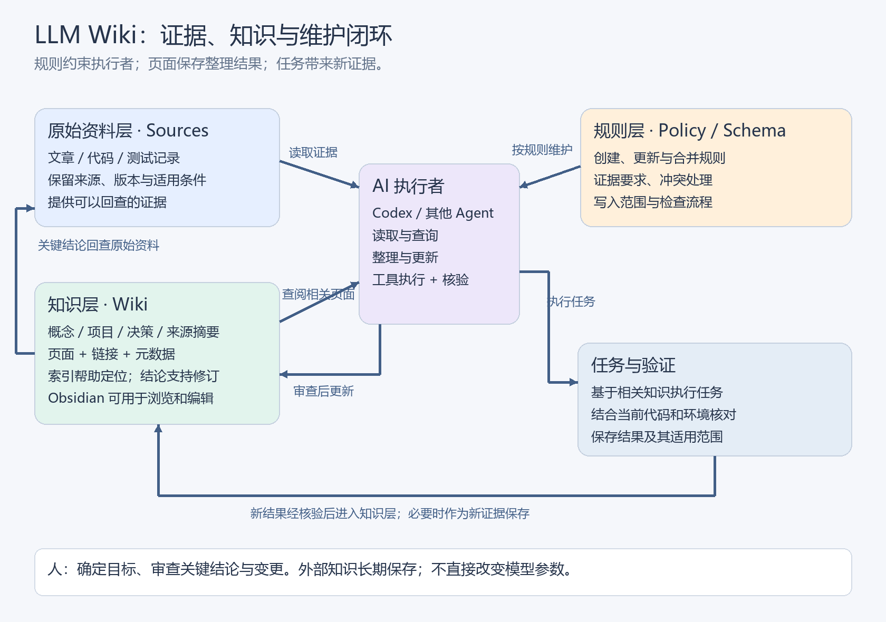

# LLM Wiki：原理、Obsidian 知识层与 Codex 协作

> 本文面向第一次接触 LLM Wiki 的读者，从知识管理问题出发，说明其架构、与 Obsidian、知识图谱和 RAG 的关系，以及如何与 Codex 形成知识复用闭环。文中的目录、元数据和工程流程属于教学设计示例，不代表某个软件的固定实现。

## 1. 从保存资料到积累可复用知识

假设一个团队准备开发文档问答助手。此前已经保存了技术文章、设计文档、代码和测试记录，但每次开始新任务，仍要重新寻找资料、比较方案，并解释过去为什么做出某个决定。

问题并不只是资料少，而是**原始资料尚未被整理成能够持续更新、相互关联、供后续任务使用的知识**。一个文件夹保存了十篇文章，并不等于团队已经拥有一份清楚说明“这些方法有什么共同点、哪些结论已经验证、哪些适用于当前项目”的知识页面。

LLM 是 Large Language Model，即大语言模型；Wiki 是由相互关联的页面组成、可以持续编辑的知识库。本文讨论的 **LLM Wiki，是让大语言模型参与整理和维护持久化知识页面的一种工作模式**。

它既可以通过普通 Markdown 文件和 AI 工具实现，也可以由专门的软件提供。Markdown 是一种用纯文本表示标题、列表和链接的文档格式，因此知识页面可以直接阅读、编辑和保存。

Karpathy 的 [LLM Wiki 原始说明](https://gist.github.com/karpathy/442a6bf555914893e9891c11519de94f) 将它描述为一种构建知识库的模式，而非一个必须安装的指定应用。本文使用“LLM Wiki”时，主要指这种架构；具体产品会在后文单独介绍。

理解这套模式，需要沿着一条主线展开：**资料提供证据，Wiki 保存整理后的认识，规则约束维护过程，AI 执行读取和更新，人负责目标与关键判断。**

## 2. 三层架构：证据、知识和维护规则

为了让知识能够长期复用，需要区分三个问题：知识从哪里来、目前有哪些认识，以及这些认识应该怎样更新。三层架构分别回答这三个问题。



*图 1：原始资料提供证据，知识层保存整理后的页面，规则层约束 AI 的读取与更新；任务结果经过核验后形成新的输入。Obsidian 可用于浏览和编辑知识层。图中关系是本文的教学架构，不是特定产品的运行截图。*

### 2.1 原始资料层：保留能够回查的证据

原始资料层可以保存论文、文章、会议记录、代码版本、实验结果和测试报告。它回答的是：“这一认识依据什么？”

整理过程中应保留原始证据，避免用 AI 摘要覆盖来源。例如，模型可能把“某种条件下表现较好”总结成“始终更好”。保留原文后，读者才能发现条件被遗漏，并修正知识页面。

“原始”不等于“正确”。一篇文章可能过时，一段对话可能只是猜测，一次测试可能仅覆盖某个环境。知识页面仍需要记录来源性质和适用条件。

也不必复制所有外部资料。对于大型代码仓库，可以记录仓库地址、提交版本、相关路径和必要摘录；对于会变化的网页，可以记录访问时间或保存允许保留的版本。重点是后续能够定位证据。

### 2.2 知识层：将多份资料整合到稳定主题中

知识层保存概念、实体、主题综述、项目决策和来源摘要等页面。其中，**概念**可以是“外部记忆”这样的抽象方法，**实体**可以是某个项目、工具或组织。

它与“每篇文章生成一份摘要”的区别，在于新资料会影响已有主题。

例如，先导入一篇介绍外部记忆的文章，生成 `外部记忆.md`；随后导入一次文档问答助手的测试报告，维护者还需要判断：

- 测试结果是否补充了外部记忆的适用条件？
- 是否需要更新项目页面中的检索方案？
- 结果与已有结论是否冲突？
- 哪些页面应建立链接，哪些页面应保持独立？

知识层因此保存的是**跨来源的整理结果**，而不只是资料目录。

### 2.3 规则层：规定 AI 如何维护知识

规则层可以包含页面模板、命名约定、来源要求、写入边界、冲突处理方式和检查流程。这里的 Schema 指知识的组织规范，例如页面有哪些类型、需要哪些字段。

规则应该能够回答具体问题：遇到同名概念时是合并还是新建？测试结果能否写成普遍结论？存在相互矛盾的资料时，是否保留不同条件？哪些页面需要人工审查？

规则可以写在 `AGENTS.md`、维护说明或可复用工作流中，但**写下规则还需要有执行者、可用工具和明确触发条件**。一个文件不会自行监控新资料、执行整理或保证内容正确。

这三层是职责划分，不要求物理上放在三个独立位置。原始资料与 Wiki 可以位于同一个目录中，也可以通过路径和来源记录关联。

## 3. Obsidian 可以承载知识层，但不等于整个系统

三层架构明确后，就可以理解 Obsidian 在其中的位置。Obsidian 是用于管理和阅读笔记的应用；Vault 是它打开的一组本地文件，通常包含 Markdown 笔记和附件。

因此，**LLM Wiki 的第二层可以由 Obsidian Vault 中的知识页面承载**。更准确的对应物是这些持久化文件，而非 Obsidian 应用本身。AI 可以通过文件工具维护页面，Obsidian 则提供阅读、编辑和导航界面。

| LLM Wiki 中的对象 | Obsidian 中的对应形式 | 需要注意的边界 |
|---|---|---|
| 知识页面 | Markdown 笔记 | 一页可以综合多份来源 |
| 页面关联 | 内部链接、反向链接 | 存在链接不代表关系已被严格定义 |
| 主题入口 | 索引笔记、MOC | MOC 是 Map of Content，即内容导航页 |
| 页面属性 | Properties / YAML Frontmatter | YAML Frontmatter 是文件顶部的元数据区 |
| 原始资料 | 来源目录和附件 | 附件不自动成为经过核验的知识 |
| 维护规则 | 规则文档、模板或工作流 | 需要明确由谁、何时执行 |
| AI 维护者 | Codex 或其他 Agent | 需要能读取并修改指定文件 |

Obsidian 支持 `[[页面名]]` 形式的 Wikilink，也支持标准 Markdown 链接。详见 [Obsidian 内部链接说明](https://help.obsidian.md/Linking+notes+and+files/Internal+links)。

**所谓“双向链接”通常是可以查看反向引用，并不意味着两个页面都自动写入了互相指向的链接。** A 页面引用 B 页面后，B 的反向链接视图可以显示 A；这也不代表 AI 已经分析了二者的语义关系。

普通人工工作流由人阅读、创建页面、建立链接和修正旧内容；LLM Wiki 工作流将其中一部分维护任务交给 AI。差异主要体现在知识生命周期如何被执行，而不是文件后缀是否为 `.md`。

这也意味着 LLM Wiki 不依赖 Obsidian。纯 Markdown 仓库、其他编辑器，或结合数据库的系统，都可以承载相似的知识层。

## 4. 页面链接形成知识网络，关系类型进一步支持知识图谱

Obsidian 的图谱视图把页面显示为节点，把链接显示为连线。节点和连线构成一个图，因此它很像知识图谱。但“页面之间有链接”与“关系已经可以被机器明确查询”之间，还有一步。

关于实体、关系类型与证据层的进一步说明，可参阅 [[知识图谱]]；本节重点说明普通页面链接与明确语义关系之间的边界。

### 4.1 普通链接表达了关联，但语义可能仍在正文中

例如，一篇 `文档问答助手.md` 引用了 `外部记忆.md`。这说明两篇笔记有关联，关系可能是“使用”“比较”“待评估”，也可能只是背景引用。

读者或模型可以阅读正文判断含义，但仅凭链接本身，通常无法确定关系类型。

### 4.2 明确关系类型后，可以表达更精确的事实

知识图谱常将知识表示为实体及其明确的关系。一种常见表示方式是三元组：**主体、关系、客体**。例如下面这条教学记录：

```text
(文档问答助手, 使用, 外部记忆)
```

如果采用项目约定的元数据，可以表示为：

```yaml
---
type: project
relations:
  - type: uses
    target: 外部记忆
---
```

这段 YAML 是教学示例。`relations` 字段和 `uses` 类型需要由维护规则定义；添加字段后，也需要工具读取和校验，才能执行“找出所有使用外部记忆的项目”等查询。

因此，可以将普通笔记链接理解为**知识网络**，将明确实体、关系类型、属性和来源的结构理解为更接近知识图谱的表示。知识图谱有多种实现，并不一定要求使用特定数据库。

LLM Wiki 可以采用普通链接，也可以引入类型化关系。是否需要进一步结构化，取决于任务：阅读和主题导航往往只需页面链接；精确的关系查询和一致性检查则更依赖明确的结构。

### 4.3 有链接，还需要实际读取关联页面

假设 AI 找到了 `文档问答助手.md`，随后可以读取它引用的 `外部记忆.md`，再根据当前问题决定是否读取检索设计页面。这是一种沿关系扩展上下文的方式。

但链接不会自动把全部相关内容送给模型。维护者需要根据任务筛选页面、控制读取范围，并在关键结论处回查来源。否则，关联越多，越可能引入无关信息。

## 5. LLM Wiki 与 RAG：知识维护和检索可以配合

RAG 是 Retrieval-Augmented Generation，即检索增强生成：回答问题时，先从外部资料中找到相关内容，再将这些内容交给模型生成回答。

常见的基础 RAG 流程是：文档分块、建立索引、检索相关片段、生成答案。“分块”是将长文档切成便于检索的段落；索引则帮助系统寻找这些段落。检索可以使用关键词，也可以将文本编码成向量，寻找语义相近的内容。

LLM Wiki 强调另一项工作：**在资料进入时，将新的认识整合进已有知识页面，并在后续持续更新**。

| 维度 | 常见基础 RAG 工作流 | LLM Wiki 工作流 |
|---|---|---|
| 主要关注 | 为当前问题找到相关证据 | 维护可持续复用的知识 |
| 常见组织方式 | 文档片段和检索索引 | 主题页面、链接、元数据和索引页 |
| 跨来源综合 | 常在回答时完成 | 可以提前保存到主题页面中 |
| 新资料进入后 | 更新文档与检索索引 | 还需判断哪些旧认识应更新 |
| 典型风险 | 检索漏召回、上下文不足 | 总结失真、旧结论未修正、冲突被覆盖 |

这里比较的是常见工作流，不能据此断言“所有 RAG 都没有积累能力”。RAG 可以包含知识图谱、持续更新和答案沉淀等机制；LLM Wiki 也可以使用 RAG 来检索自己的页面。

二者组合时，一种设计是：新资料先经过整理进入 Wiki；提问时检索相关 Wiki 页面；遇到细节、争议或版本问题，再检索原始证据。这既利用整理结果，也保留回查能力。

## 6. 长期记忆保存在哪里

当 Wiki 页面长期保存在磁盘中，它就可以作为 Agent 的外部记忆。Agent 在本文中指能够围绕任务使用模型和工具、执行多个步骤的系统。

这种“记忆”需要区分三个对象：

- **模型参数**：模型训练得到的权重。保存 Markdown 文件不会直接修改这些权重。
- **当前上下文**：模型本次实际收到的指令、消息和读取内容。
- **外部存储**：磁盘中的 Wiki、来源文件和检索索引。

一个新会话能够利用旧知识，是因为系统重新检索并读取了相关文件。知识在外部长期存在，模型在当前上下文中使用它。

因此，“保存下来”与“下一次用上”是不同的事情。能否复用，还取决于索引是否准确、页面是否及时更新、Agent 是否读取了正确文件，以及证据是否足够。知识库也可能同时保存正确经验和错误总结，持久化本身不证明质量。

## 7. AI 如何维护：导入、查询和检查

前面介绍了知识的存储和组织，接下来需要说明它如何变化。LLM Wiki 的原始模式概括了三项操作：Ingest、Query 和 Lint，即导入整理、查询和健康检查。以下流程是对这些操作的教学展开，实际实现可不同。参见 [LLM Wiki 原始说明中的 Operations](https://gist.github.com/karpathy/442a6bf555914893e9891c11519de94f#operations)。

### 7.1 导入整理：让新资料影响相关主题

一次导入可以依次执行：

1. 记录来源、时间和版本，阅读资料中的结论与条件。
2. 查询现有页面，判断是否已有对应主题，避免同义词造成重复页面。
3. 提出新增、更新或合并方案，区分原文事实与整理者的解释。
4. 对有冲突的内容检查版本、环境和测试条件，保留尚未解决的差异。
5. 更新允许修改的页面，并同步必要的索引和操作记录。

例如，“旧方案在环境 A 成功，新方案在环境 B 失败”未必是矛盾；二者可能只是条件不同。AI 不能简单用最新文字覆盖旧记录。

### 7.2 查询：把知识与当前问题连接起来

一次查询可以先从索引或搜索结果找到入口，再读取相关页面，沿必要链接补充上下文，最后形成带依据的回答。

查询产生的新比较或分析也可能值得保存，但应先判断它是否增加了可复用认识。若只是重述已有页面，继续新增笔记会造成重复；若包含未经验证的猜测，则应保留为待验证内容。

### 7.3 健康检查：发现结构问题与知识问题

随着页面增加，维护者需要检查失效链接、重复概念、缺少来源的结论、过期版本信息，以及尚未解释的冲突。

检查可以分两类：

| 检查方式 | 能发现的典型问题 | 能力边界 |
|---|---|---|
| 确定性检查，例如脚本校验 | 文件不存在、必填字段缺失、链接目标错误 | 不能据此判断技术结论正确 |
| AI 阅读与人工审查 | 语义重复、条件遗漏、可能的冲突 | 判断仍需回查证据，可能有误 |

索引页和操作日志也承担不同职责：索引页帮助找到“现在有哪些知识”，日志帮助追踪“何时发生了什么变化”。版本管理工具 Git 可以记录文件修改历史，但它同样不能证明内容正确。

## 8. Codex 如何参与知识复用闭环

Codex 可以作为实际执行者，在可访问的工作环境中读取资料、分析代码、修改文件并执行检查。LLM Wiki 保存跨任务复用的知识；人负责目标、重要结论和最终方案。

### 8.1 指令、工作流与工具各有什么作用

| 组成 | 在 Wiki 协作中的作用 |
|---|---|
| `AGENTS.md` | 说明工作范围、知识入口、写入规则和检查要求 |
| Skill | 封装重复流程，例如导入资料或整理任务结果 |
| 文件读写、搜索等工具 | 实际定位、读取和更新页面 |
| 人的审查 | 判断关键结论是否可信、修改是否符合目标 |

OpenAI 官方文档说明 Codex 会按发现规则加载 `AGENTS.md` 指令；Skill 则以 `SKILL.md` 和可选资源组织可复用工作流程。详见 [AGENTS.md 指南](https://learn.chatgpt.com/docs/agent-configuration/agents-md) 和 [Skills 指南](https://learn.chatgpt.com/docs/build-skills)。

这不意味着一份规则文档能够自动连接任意外部 Vault。知识库路径、可访问范围和工具能力需要实际配置；规则也应给出明确入口，避免让执行者猜测去哪里寻找资料。

### 8.2 两种协作方式

**直接文件协作**：Codex 读取维护规则和相关 Markdown 页面，通过文件工具更新知识。结构简单，容易查看修改。

**通过专门工作流或工具协作**：将导入、查询、检查等步骤封装为 Skill，或使用应用提供的搜索与读写接口。适合希望统一流程的场景。

MCP 是 Model Context Protocol，即模型上下文协议，可作为连接外部工具的一种方式；它不是实现 Wiki 的必选项，也不负责替代知识维护规则。直接读写文件就可以构成协作的基础。

两种方式可以并存。选择时应关注知识是否可定位、更新是否可审查、来源是否可回查，而不只是是否带有某个工具名称。

### 8.3 一个贯穿完整任务的教学示例

以下是虚构的“文档问答助手”开发场景，用于展示闭环，不是已运行项目的测试结果。

**任务目标**：增加远程检索服务的调用能力，并明确失败后的处理方式。

任务开始时，Codex 读取项目规则和项目架构页面，再查询“外部记忆”“检索服务”和“重试策略”等相关主题。页面提供历史背景，实际代码和当前环境用于确认这些背景是否仍成立。

随后，Codex 实现调用逻辑并执行测试。假设本次测试发现：在指定测试环境中，某类请求失败后再次尝试能够恢复，而另一些请求需要直接报告错误。

任务结束时，不能只写“请求失败都应重试”。应分别保存：

- **项目事实**：具体模块实现了什么行为，使用了哪个版本。
- **验证证据**：测试环境、覆盖场景和结果。
- **项目决策**：为何选择该处理策略，以及没有覆盖的条件。
- **可复用认识**：重试策略应结合错误类型和操作是否可以安全重复执行。

经过核验的项目内容写入项目知识；通用认识写入相应主题，并链接证据。下一次任务读取这些页面后，还需要核对新项目条件，再决定是否沿用策略。

这解释了“经验积累”的真实含义：**外部知识被更新，后续执行者有机会复用；并不意味着模型权重因此训练了一次，也不保证下一次必然做得更好。**

对话中常见的“某种传输一定需要心跳”“某个 SDK 有缺陷”等工程句子，也应按这个原则处理：只有结合协议、版本和复现证据，才能写成相应范围内的结论。

## 9. 一个最小知识库怎样组织

明确闭环后，目录可以围绕证据、知识、规则和导航设计。下面仅展示一种教学布局，不是对现有笔记库的改造要求：

```text
knowledge-workspace/
├── AGENTS.md                  # 工作范围与维护规则
├── raw/                       # 原始资料及证据记录
│   ├── articles/
│   └── test-reports/
├── wiki/                      # 整理后的持久化知识
│   ├── concepts/              # 通用概念
│   ├── projects/              # 项目事实与决策
│   ├── sources/               # 来源摘要，与 raw 中的证据区分
│   ├── index.md               # 内容导航
│   └── log.md                 # 维护操作记录
└── assets/                    # 页面使用的图片和附件
```

通用技术知识与项目事实具有不同的更新规律。例如，“检索增强生成的基本流程”是通用概念，“某项目当前使用哪个检索服务”是项目事实，“为什么选择该服务”是项目决策。分别组织后，通过链接建立关系，可以减少版本变化时的混淆。

规则也应尽量具体。一个示例约定可以是：

```text
读取：从索引定位任务相关页面，必要时回查来源。
新增：先检查是否存在同一主题；有则更新，无则创建。
证据：项目结论注明版本、测试范围和来源位置。
冲突：保留不同条件及证据，未解决时标为待验证。
写入：仅修改指定知识页面，不覆盖原始证据。
检查：核对链接、元数据和修改内容，记录变更摘要。
```

还可以区分“待验证”“在指定条件下已验证”“已被新证据替代”等状态，但状态本身只是标记。读者仍应能看到对应证据，尤其不能把一次局部测试理解成全面验证。

从小范围验证闭环比较容易看清效果：选一份来源，完成导入和页面更新；提出一个需要跨页面回答的问题；再引入一份新证据，检查旧页面是否被正确修订。只有这条路径实际运行，才说明知识正在被维护和复用。

## 10. 同名项目怎样区分

LLM Wiki 是架构名称，也被多个具体项目使用。下表根据 2026 年 10 月 9 日访问的项目说明整理，仅说明实现形态，不构成安装建议或本地兼容性验证。

| 来源或项目 | 实现形态与定位 |
|---|---|
| [Karpathy 的 LLM Wiki 说明](https://gist.github.com/karpathy/442a6bf555914893e9891c11519de94f) | 描述知识维护模式的理念文档 |
| [nashsu/llm_wiki](https://github.com/nashsu/llm_wiki) | 将资料整理为关联知识库的桌面应用；是具体实现，不能当作 Karpathy 原文 |
| [arronKler/llm-wiki](https://github.com/arronKler/llm-wiki) | 面向 AI Agent 的本地 Markdown 知识系统与 Skills，声明支持 Codex，Obsidian 为可选前端 |
| [microsoft/llmwiki](https://github.com/microsoft/llmwiki) | 以 VS Code 扩展为界面，并提供核心 Wiki 操作和 MCP 工具 |
| [llmwiki.cc](https://llmwiki.cc/docs) | 通过本地浏览器界面使用的知识库应用，文档介绍了云端或本地模型接入 |

产品支持某个 Agent，不代表它会自动读取该 Agent 的全部历史会话，也不代表所有任务结果都会被自动保存。“本地优先”描述存储或运行设计，也不能单独证明资料从不发送到模型服务；具体行为需要检查模型配置和实际调用路径。

后续评估实现时，应检查：文件格式和来源记录能否保留、能否访问目标知识库、如何处理旧页面与冲突、写入是否可审查，以及能否完成一次真实的读取—执行—验证—更新任务。

## 11. 复习主线与适用边界

LLM Wiki 解决的核心问题，是将散落的资料和任务经验整理成可持续更新、供后续使用的知识。它适合来源持续增加、需要跨资料综合、同类任务反复发生的场景；对于一次性阅读，持续维护 Wiki 的成本未必有必要。

可以用五个问题重建全文：

1. **知识从哪里来？** 原始资料提供可回查的证据，但来源仍需判断。
2. **知识保存成什么？** 页面、链接和元数据组成持久化知识层，Obsidian 可以承载和展示它。
3. **如何找到并使用知识？** 索引、搜索和必要的关系扩展构建当前任务的上下文，RAG 可以参与这一过程。
4. **谁来维护？** AI 按规则和工作流执行读取与更新，人决定目标并审查关键结论。
5. **为何不会越积越错？** 必须保留来源与条件、处理冲突、修正过期结论，并验证实际复用路径。

页面更多、连线更多或自动化程度更高，都不能单独证明知识质量更好。有效的积累还包括合并重复内容、缩小不成立的结论、保留未解决问题，以及让下一次任务真正找到适用的证据。

## 参考资料

- [Karpathy：LLM Wiki 原始模式说明](https://gist.github.com/karpathy/442a6bf555914893e9891c11519de94f)
- [Obsidian：Internal links](https://help.obsidian.md/Linking+notes+and+files/Internal+links)
- [OpenAI：Custom instructions with AGENTS.md](https://learn.chatgpt.com/docs/agent-configuration/agents-md)
- [OpenAI：Build skills](https://learn.chatgpt.com/docs/build-skills)
- 具体实现的官方仓库与产品文档见第 10 节。
