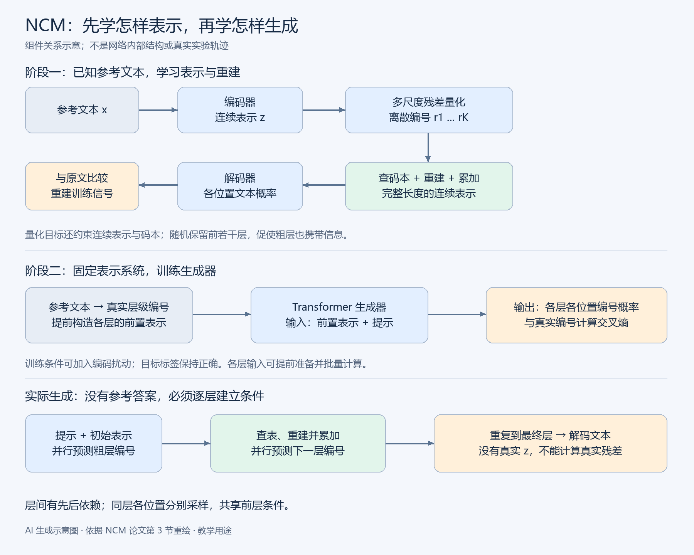
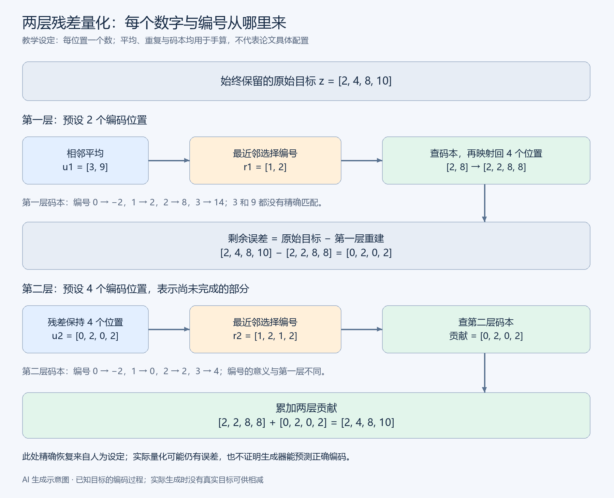

# Next-Concept Modeling 详解：从数值例子到分层并行生成

Next-Concept Modeling（NCM）研究的是：**怎样在保留文本各位置之间依赖的同时，减少生成过程中必须串行等待的步骤？** 它先把文本表示成从粗到细的多层离散编码，再用 Transformer 逐层生成编码，同一层的多个位置并行预测，最后解码成文本。

理解这项工作的价值，不在于接受“模型先像人一样想好全文”这个类比，而在于看清一种不同的生成组织方式：自回归模型主要沿着文本位置推进，NCM 沿着表示层级推进。这里的 concept 指粗层携带的信息，不是人工规定的概念标签，也不是必然对应一句话的向量。

本文先解释并行预测为何困难，再用一个完整、可手算的两层例子建立数据流，随后把例子对应到张量、量化、训练目标、概率模型与计算成本。阅读后应能区分：从已知原文构造编码、根据条件预测编码，以及根据编码恢复文本。

> **资料与证据范围**：方法依据论文 arXiv:2610.14162v1、作者技术介绍和官方项目。文中的标量、码本、平均与重复操作是教学设定；示意算法不等于源码实现。实验数字是作者报告，本文没有运行模型、复现实验或验证大规模部署表现。

## 1. 从问题出发：并行输出为什么需要协调

### 1.1 自回归生成保留依赖，但有顺序链

设文本有长度为 $L$ 的 token 序列 $x=(x_1,\ldots,x_L)$ 。概率链式法则允许写成：

$$p(x)=\prod_{t=1}^{L}p(x_t\mid x_{<t})$$

其中 $x_{<t}$ 是第 $t$ 个位置以前的内容。这个分解本身是精确的概率恒等式，不要求位置独立。

生成时，第一个 token 尚未产生，第二个位置就不能把它作为已知条件；因此通常需要沿位置顺序推进。训练时完整文本已知，可以使用因果掩码并行计算各位置损失，不能把训练并行误认为采样时也没有依赖。

### 1.2 直接独立预测所有位置会丢失关系

假设合法输出只有 00 和 11，各占一半：

$$p(00)=p(11)=\frac12,\qquad p(01)=p(10)=0$$

单独看任意位置，0 和 1 都各占一半。如果把两个位置独立采样，会得到：

$$p_{\mathrm{ind}}(00)=p_{\mathrm{ind}}(01)=p_{\mathrm{ind}}(10)=p_{\mathrm{ind}}(11)=\frac14$$

一半结果违反了原本“两个位置必须相同”的关系。自然语言中的人物一致性、否定关系、数值与单位，以及代码变量的定义和使用，都有类似的跨位置约束。

### 1.3 共享条件可以承载位置之间的依赖

引入共同变量 $h$ ，先以相等概率选择 0 或 1，再让两个位置都复制它：

$$p(h=0)=p(h=1)=\frac12,\qquad x_1=h,\quad x_2=h$$

| 共享条件 | 第一个位置 | 第二个位置 | 结果概率 |
|---|---|---|---|
| 0 | 0 | 0 | 1/2 |
| 1 | 1 | 1 | 1/2 |

给定 $h$ 后，两个位置都确定，满足条件独立：

$$p(x_1,x_2\mid h)=p(x_1\mid h)p(x_2\mid h)$$

这不是任意变量都满足的恒等式；一般的链式分解仍然包含 $p(x_2\mid x_1,h)$ 。本例因已知共同条件后没有剩余不确定性，才能去掉对第一个位置的额外依赖。

不知道 $h$ 时，需要按全概率公式汇总所有可能情况。所谓“消去”或“边缘化”，是对可能的条件加权求和，不是把共同来源删除：

$$p(x_1,x_2)=\sum_h p(h)p(x_1\mid h)p(x_2\mid h)$$

计算 00 时，第一种情况是选择 0 后两个位置都输出 0；第二种情况是选择 1 后两个位置都输出 0。后者不可能发生：

$$p(00)=\frac12\times1\times1+\frac12\times0\times0=\frac12$$

同理：

$$p(11)=\frac12\times0\times0+\frac12\times1\times1=\frac12$$

$$p(01)=\frac12\times1\times0+\frac12\times0\times1=0$$

因此，给定共同条件后分别生成，仍然能够产生整体相关的结果。NCM 的粗层提供一种共享条件，但真实学习不保证它已经包含细层所需的全部协调信息。

## 2. 整体框架：先学怎样表示，再学怎样生成

理解 NCM 要分开三种工作：

1. **编码**：已知参考文本，为它找到多层离散编号。
2. **重建**：拿到编号，通过码本和解码器恢复文本。
3. **生成**：不知道参考答案，由生成器预测编号，再重建和解码。

第一训练阶段学习表示系统，第二训练阶段冻结表示系统、训练生成器。实际使用时，没有真实答案可供编码，生成器必须自行产生层级编码。



图：AI 生成示意图。上半部分表示参考文本如何成为编码与重建目标，下半部分区分生成器训练和实际生成。箭头表达组件之间的数据关系；不表示完整源码或网络内部结构。结构依据论文第 3 节，图为本笔记重新绘制。

## 3. 贯穿例子：从一句已知文本构造两层编码

本节先处理已知答案。其目标不是产生新句子，而是制作生成器以后能够学习的分层表示。

### 3.1 从文本编号到连续表示

以“小猫躲进一个纸箱”为示意文本，假设分为四个 token：小猫、躲进、一个、纸箱。人为给定文本编号为 0、1、2、3，则：

$$x=[0,1,2,3]$$

编号只是词表标签，不表示语义大小。编码器将文本编号映射到连续表示：

$$z=E_\phi(x)$$

其中 $E_\phi$ 是编码器， $\phi$ 是其可学习参数。为便于手算，假设输出是：

$$z=[2,4,8,10]$$

这些数值是教学指定，不是词义的真实测量，也不是论文的编码输出。实际每个位置通常对应高维向量。

### 3.2 粗层为什么只有两个位置

预先选择一个两层结构：第一层有两个编码位置，第二层有四个。粗层长度是模型配置的一部分，不是平均运算算出的结果，也不是“四个位置必须除以二”的规律。

“两个位置”不是“两位数”：无论数值是 3、9，还是 100、200，都可以组成两个位置。在高维情形中，这两个位置各自还是一个向量。

### 3.3 降采样产生新变量，不改变原始目标

选择相邻平均作为本例的降采样操作：

$$u_1=\mathrm{Down}_1(z)=\left[\frac{2+4}{2},\frac{8+10}{2}\right]=[3,9]$$

这时原始目标仍然是四个数，只有新得到的粗表示是两个数：

$$z=[2,4,8,10],\qquad u_1=[3,9]$$

平均丢失了组内差异。例如第一组从 2、4 变成 3 后，无法只靠平均值知道两者原本相差多少。降采样没有把原来的目标覆盖掉。

### 3.4 有限码本不一定包含想表达的数

假设第一层码本为：

| 编号 | 对应数值 |
|---|---|
| 0 | -2 |
| 1 | 2 |
| 2 | 8 |
| 3 | 14 |

表里既没有 3，也没有 9。量化采用最近邻选择：

- 3 距离数值 2 最近，因此选择编号 1。
- 9 距离数值 8 最近，因此选择编号 2。

于是第一层编码为：

$$r_1=[1,2]$$

码本不是每遇到一个输入，就临时放入它需要的精确答案。真实系统在训练中学习有限的代表向量；同一层多个位置共享该层码本，不同层可以有不同码本。

### 3.5 编号、查表值和重建结果是三个对象

根据编号查表，得到：

$$q_1=e_1(r_1)=[2,8]$$

其中 $e_1$ 表示查询第一层码本。这里应明确区分：

| 对象 | 本例取值 | 意义 |
|---|---|---|
| 连续粗表示 | 3、9 | 量化前想表达的信息 |
| 离散编号 | 1、2 | 实际选择的码本标签 |
| 查表后的数值 | 2、8 | 编号代表的近似值 |

当前只有两个位置，而目标有四个位置。为便于计算，选择重复操作把它映射回原长度：

$$R_1([2,8])=[2,2,8,8]$$

因此第一层重建为：

$$\hat z^{(1)}=[2,2,8,8]$$

帽子表示近似重建，上标括号表示使用到第几层，不是乘方。重复只是示意重建算子，不是平均运算的精确逆操作。

### 3.6 残差告诉第二层还缺什么

现在两个对象长度一致，可以逐位置相减：

$$\varepsilon^{(1)}=z-\hat z^{(1)}=[2-2,4-2,8-8,10-8]=[0,2,0,2]$$

这表示第一、三位置无需补充，第二、四位置各需要加 2。第二层不必重新表达完整目标，只需表达未完成的部分。

残差同时包含降采样丢失的细节和有限码本引入的量化误差。以下三组目标平均后都会得到 3、9，但所需残差不同：

| 原始目标 | 相同的粗层重建 | 尚需补充的残差 |
|---|---|---|
| 2、4、8、10 | 2、2、8、8 | 0、2、0、2 |
| 1、5、7、11 | 2、2、8、8 | -1、3、-1、3 |
| 3、3、9、9 | 2、2、8、8 | 1、1、1、1 |

因此，粗信息不能唯一确定原目标；细层负责区分具有相似粗信息的不同实现。

### 3.7 第二层量化、累加并完成重建

第二层有四个位置，不再缩短本例的四个残差。假设它使用独立码本：

| 编号 | 对应数值 |
|---|---|
| 0 | -2 |
| 1 | 0 |
| 2 | 2 |
| 3 | 4 |

残差 0、2、0、2 对应编号：

$$r_2=[1,2,1,2]$$

查表恢复第二层贡献并累加：

$$\hat z^{(2)}=[2,2,8,8]+[0,2,0,2]=[2,4,8,10]=z$$

完全相等是因为本例有意让第二层精确表示残差。若第二层只能提供 -0.1、1.8、0.2、1.9，累加结果就仍有误差；真实模型不保证逐样本精确恢复，也不保证每增加一层都提高文本质量。



图：AI 生成示意图。展示同一已知目标如何被拆成两层编码；码本、标量和运算均为教学设定。应重点区分不变的原始目标、降采样结果、编号、码本值、重建和残差。此图不是实验输出。

### 3.8 已知目标为何还要绕一圈恢复它

如果只想传递眼前四个数，直接保存目标即可，本例没有证明数据压缩：两个粗编号加四个细编号，数量甚至超过四个原位置。

这套计算的用途是建立可逐层生成的表示，并检查这种表示有没有保留足够信息。之后，生成器学习预测这些编号。**能恢复已知答案与能生成未知答案，是两个不同的能力。**

## 4. 从例子到一般算法：符号、尺寸和递推

已经有了完整例子，下面把相同过程扩展到任意层数和向量维度。设文本长度为 $L$ ，潜在向量宽度为 $d$ ，层数为 $K$ ，第 $k$ 层有 $\ell_k$ 个位置，码本含 $V_k$ 个向量。

| 符号 | 含义 | 两层例子 |
|---|---|---|
| $x$ | 文本 token 序列 | 0、1、2、3 |
| $z$ | 原文连续表示 | 2、4、8、10 |
| $\hat z^{(k)}$ | 前面各层的累积重建 | 第一层后为 2、2、8、8 |
| $\varepsilon^{(k)}$ | 当前未表达的残差 | 第一层后为 0、2、0、2 |
| $u_k$ | 当前残差降采样后的连续表示 | 第一层为 3、9 |
| $r_k$ | 当前层离散编号 | 第一层为 1、2 |
| $e_k(r_k)$ | 码本查询结果 | 第一层为 2、8 |
| $R_k$ | 映射到原长度的重建算子 | 本例使用重复或恒等映射 |

### 4.1 初始化：第一层为何直接处理原表示

还没有加入信息时，定义：

$$\hat z^{(0)}=0,\qquad \varepsilon^{(0)}=z-\hat z^{(0)}=z$$

第一层处理完整目标，是统一残差公式在零初始化下的特例，不需要另一套规则。

### 4.2 每一层都执行相同的四步

先把剩余误差调整到当前层长度：

$$u_k=\mathrm{Down}_k(\varepsilon^{(k-1)})\in\mathbb R^{\ell_k\times d}$$

对每个位置选择最近的码本向量编号：

$$r_k^i=\arg\min_{j\in\{0,\ldots,V_k-1\}}\|u_k^i-e_{k,j}\|_2^2$$

这里与数值例子一样采用从 0 开始的码本编号，候选项共 $V_k$ 个；论文使用从 1 开始的编号，两种约定只差索引标签，不改变最近邻算法。

这个公式中，最小值是距离，取得最小值的编号才是离散编码。高维距离就是各维差值平方之和：

$$\|u-e\|_2^2=\sum_{a=1}^{d}(u_a-e_a)^2$$

再查表、重建、累加：

$$\hat z^{(k)}=\hat z^{(k-1)}+R_k(e_k(r_k))$$

最后更新剩余误差：

$$\varepsilon^{(k)}=z-\hat z^{(k)}$$

码本查询结果的尺寸是 $\ell_k\times d$ ，累积表示的尺寸是 $L\times d$ 。重建算子保证它们可以相加。原始目标始终保留，变化的是其近似与残差。

### 4.3 层级数不是 Transformer 网络深度

表示层级沿从粗到细的生成过程展开；一次预测某个表示层级时，数据仍然会经过生成器内部多个 Transformer block。增减表示层级与增减网络 block，是不同的设计选择。

码本是有限的离散候选，生成器可以用 softmax 分类；这并不证明连续预测不可行，也不意味着所有编号天然可解释为人类概念。

## 5. 第一阶段训练：怎样让这种表示有用

前面使用了给定的编码器和码本。真实训练还要学习这些组件，使分层编码既能保留信息，也能逐步重建文本。

### 5.1 解码器与重建交叉熵

解码器接收累积连续表示，为原文各位置输出文本词表概率。它不是查潜在码本，也不必把某个连续数值机械替换为一个词。

若第一个位置原文是“小猫”，模型给它的概率从 0.1 提高到 0.8，对应负对数损失从约 2.303 降到 0.223。所有位置的平均重建损失为：

$$\mathcal L_{\mathrm{rec}}=-\frac1L\sum_{i=1}^{L}\log p_\psi(x_i\mid\hat z)$$

这里 $\psi$ 是解码器参数。直接检查文本重建很重要：隐藏向量距离小，不保证否定、人名或数字都恢复正确。

### 5.2 为什么只检查最终层还不够

如果只要求完整层级重建正确，模型可能把重要信息留给最后的细层，前面的层几乎无用。Nested dropout 在训练时抽取一个截止层，只保留前若干层进行重建，促使早期层也保存有效信息。

以随机截止深度 $m$ 表示，重建部分可理解为：

$$\mathbb E_{m\sim\pi}\left[-\frac1L\sum_i\log p_\psi(x_i\mid\hat z^{(m)})\right]$$

其中 $\pi$ 是截止深度的训练分布。这是对粗层有用性的训练压力，不是“第一层一定学主题、第二层一定学人物”的监督标签。

### 5.3 连续表示与码本如何相互适应

除文本重建外，量化训练还需要限制编码器输出与量化表示之间的偏离。论文在采样截止层上使用的目标可写为：

$$\mathcal L_{\mathrm{tok}}=\mathcal L_{\mathrm{rec}}+\beta\,\mathrm{MSE}(z,\mathrm{sg}[\hat z^{(m)}])+\mathrm{MSE}(\mathrm{sg}[z],\hat z^{(m)})$$

其中 $\mathrm{sg}$ 表示停止该项的梯度， $\mathrm{MSE}$ 是均方误差， $\beta$ 控制 commitment 项权重。

- 固定量化结果的一侧，让编码器输出靠近可表达的量化结果。
- 固定编码器输出的一侧，让量化表示向它靠近。
- 重建项要求这套表示最终能恢复正确文本。

忽略平均常数，第一种平方误差对连续表示的梯度为：

$$\nabla_z\bigl(\beta\|z-\mathrm{sg}[\hat z]\|_2^2\bigr)=2\beta(z-\hat z)$$

这说明它会把连续表示拉向量化结果。实际码本更新还可以使用移动平均，不能仅凭损失表达式认定实现只有普通梯度下降。

### 5.4 最近邻不可导，怎样传回重建梯度

最近邻编号随输入变化通常保持不变，到边界再突然跳变，不能直接用其精确导数完成常规反向传播。VQ 使用直通梯度估计，简单形式为：

$$z_{\mathrm{ST}}=z+\mathrm{sg}[z_q-z]$$

前向计算等于量化向量 $z_q$ ，反向则把对 $z$ 的局部导数近似为单位映射。这样，解码器的重建信号可以回到编码器。这是有偏的梯度估计，不是精确求导。

必须区分：残差是下一层要表示的数据；损失是训练参数的优化信号；直通估计是处理离散步骤梯度的方法。

## 6. 第二阶段训练：从表示编号到生成模型

第一阶段结束后，固定 tokenizer 及其解码组件，为参考文本得到目标编码，再训练生成器。这里的 tokenizer 是多尺度潜在表示系统，不应与最初把汉字或词切成文本 token 的分词器混为一谈。

### 6.1 生成器预测什么

对每个当前层位置，Transformer 输出该层码本大小的 logits，经过 softmax 得到编号概率：

$$p_\theta(r_k^i=j\mid h_k)=\frac{\exp(a_{k,i,j})}{\sum_{v=1}^{V_k}\exp(a_{k,i,v})}$$

其中 $\theta$ 是生成器参数； $h_k$ 概括提示和前层累积表示。教师编码给出正确编号，交叉熵提高这些编号的概率。

在数值例子中，第一层目标是编号 1、2；第二层目标是编号 1、2、1、2。训练标签来自参考文本的编码，不是生成器自行知道正确答案。

### 6.2 层间依赖与层内条件独立

为简化记号，先省略提示。模型分解为：

$$p_\theta(r_{1:K})=\prod_{k=1}^{K}p_\theta(r_k\mid\hat z^{(k-1)})$$

同一层使用条件独立分解：

$$p_\theta(r_k\mid\hat z^{(k-1)})=\prod_{i=1}^{\ell_k}p_\theta(r_k^i\mid\hat z^{(k-1)})$$

给定提示时，增加条件 $c$ 即可理解相同的依赖关系。各位置共享前层表示与提示，但采样当前层时，不把刚采出的同层编号依次送回去决定后续位置。

条件独立不禁止 Transformer 在确定的当前层输入之间使用双向注意力：各位置可以共同计算分布，独立指的是给定条件后的采样分解，而不是网络内部互不通信。

### 6.3 条件独立是并行收益，也是建模限制

若共享粗表示已经协调了关键关系，细层可更容易分别产生；若没有，独立采样可能得到互不兼容的细节。

**补充教学分析**：固定共享条件 $h$ ，用真实条件分布 $P(r\mid h)$ 和独立近似 $Q(r\mid h)=\prod_iQ_i(r_i\mid h)$ 比较。将 KL 展开：

$$D_{\mathrm{KL}}(P\|Q)=-H_P(r\mid h)-\sum_i\mathbb E_P[\log Q_i(r_i\mid h)]$$

每个交叉熵在预测分布等于真实边缘分布时最小，因此：

$$\min_Q D_{\mathrm{KL}}(P\|Q)=\sum_iH_P(r_i\mid h)-H_P(r\mid h)$$

右侧刻画给定共享条件后仍剩余的总依赖。粗层若能解释更多协调信息，独立近似的负担可能减小。这是对分解结构的分析，不是论文已经证明粗层一定具备此性质。

## 7. 生成器损失、层级权重与条件扰动

### 7.1 从编码似然得到交叉熵

真实编码记为 $r^*$ 。对概率乘积取对数会变成求和，取负号得到优化损失：

$$\mathcal L_{\mathrm{gen}}=-\sum_k\sum_i\log p_\theta(r_k^{*i}\mid\hat z_*^{(k-1)})$$

星号表示由参考文本构造的目标或条件。不同层长度不同，直接求和会使长层拥有更多损失项。论文使用层级权重族：

$$\mathcal L_{\mathrm{NCM}}=-\sum_kw_k\sum_i\log p_\theta(r_k^{*i}\mid\tilde z^{(k-1)}),\qquad w_k=\frac{\ell_k^{-\alpha}}{\sum_j\ell_j^{1-\alpha}}$$

当 $\alpha=0$ 时，各编码位置权重相同；当 $\alpha=1$ 时，每层的总权重为 $\ell_kw_k=1/K$ ，各层总权重相同。这决定训练是更接近按位置平均，还是提高短粗层的相对地位。

### 7.2 为什么条件要加入错误

训练若始终提供正确的前层编码，实际生成却接收模型自己的预测，二者条件分布会不同。前层出错后，后层可能缺乏处理经验。

论文在训练时把部分条件编码换成同层码本的其他编号，再构造带扰动的累积表示 $\tilde z$ ，而正确目标标签保持不变。可把单个位置的扰动理解为：

$$\tilde r_k^i\sim\begin{cases}r_k^{*i},&\text{概率 }1-\rho_k\\\text{同层码本随机编号},&\text{概率 }\rho_k\end{cases}$$

目的在于让模型在部分条件不可靠时仍尽量预测正确后续，而不是教它输出错误标签。扰动过强也可能损害条件利用，不能认为越多越好，更不保证纠正所有错误。

## 8. 为什么训练能同时预测各层，生成却要逐层进行

### 8.1 训练可以提前准备所有层的输入

参考答案已知时，可以预先求出全部编码与每层所需的累积表示。对第 $k$ 层构造：

$$a_k=\mathrm{Project}\bigl(\mathrm{Resize}_{\ell_k}(\tilde z^{(k-1)})\bigr)$$

其作用是把前层累计信息调整到当前层长度，再映射到生成器隐藏维度。把各层输入块拼接后，生成器可以在一次前向中计算各层预测。

### 8.2 注意力掩码防止目标泄露

无条件设置使用块对角注意力，各层块只读取自己的输入块；该输入本身已经汇总较粗层信息。若任意读取后面层的训练输入，可能间接看到当前层目标，造成泄露。

有提示的生成使用相应的 prefix-LM 模式：提示位置彼此可见，目标块可读取提示和自己的块，提示不能读取目标块。这里不是普通逐 token 的下三角掩码。

### 8.3 生成时条件尚未存在

数值例子的第二层需要第一层重建 2、2、8、8。使用模型时，这个表示只有在第一层编号产生后才存在。因此先完成第一层，再计算第二层。

一次训练前向计算所有预测，不等于一次推理前向就能得到所有层。区别来自训练时目标编码可提前获取，生成时不可获取。

## 9. 实际生成：没有原文，也不计算真实残差

在使用模型时，已知提示，但不知道参考文本和真实连续目标。过程如下：

1. 从零初始化的累积表示开始；提示、位置和层级等信息使预测并非“毫无条件”。
2. 生成器并行预测第一层各位置编号。
3. 查码本，重建并累加得到第一层表示。
4. 根据已有表示和提示，并行预测下一层编号。
5. 重复至最后一层，最终解码器对文本位置输出概率并选择 token。

示意伪代码只表达数据依赖，不是可执行的仓库复现：

```text
累积表示 = 零初始化
对每个从粗到细的层级：
    当前输入 = 将累积表示调整到当前层长度并投影
    编号概率 = 生成器(当前输入，提示，位置与层级信息)
    当前层编号 = 并行采样各位置的编号
    当前贡献 = 当前层码本查询后，映射回完整长度
    累积表示 = 累积表示 + 当前贡献
文本概率 = 解码器(累积表示)
最终文本 = 对各位置选择文本 token
```

最关键的区别是：**真实残差只在已知目标的编码过程中计算；实际生成时，生成器预测残差的离散表示，没有参考答案可供相减。**

| 已知答案的编码阶段 | 未知答案的生成阶段 |
|---|---|
| 编码器读取参考文本 | 没有参考文本可读取 |
| 根据目标计算残差 | 不知道真实残差 |
| 最近邻选择目标编码 | 生成器预测编码概率并采样 |
| 检查能否恢复参考文本 | 累加并解码新文本 |

可以在每层后临时解码，观察文本如何变化。后层并未重采早层编号，而是加入新贡献，改变了累计表示。中间文字因此可能被修正，但这不等于能无条件回滚粗层错误，也不保证质量单调提升。

## 10. 编码模型怎样对应文本概率与 ELBO

前面已经学习了编码分布和给定编码后的文本分布，现在要说明两者如何组成生成模型。以下对应论文附录 A 的无条件、固定 tokenizer 设置。

### 10.1 从联合分布到文本边缘概率

把全部层的编号简写为 $r$ 。先生成编号，再解码文本，定义联合分布：

$$p_{\theta,\psi}(x,r)=p_\theta(r)p_\psi(x\mid r)$$

同一文本可能由多个编码组合产生，所以按全概率公式求和：

$$p_{\theta,\psi}(x)=\sum_r p_\theta(r)p_\psi(x\mid r)$$

这和前面的共享变量例子是同一种边缘化思想。组合数量巨大，通常无法直接枚举全部编码。

### 10.2 用确定编码构造可计算下界

固定 tokenizer，为参考文本确定一套编码 $r^*(x)$ 。由于求和包含该编码对应的非负项：

$$p(x)\ge p_\theta(r^*)p_\psi(x\mid r^*)$$

对数函数单调递增，因此：

$$\log p(x)\ge\log p_\theta(r^*)+\log p_\psi(x\mid r^*)$$

右侧一项要求编码容易被生成器产生，另一项要求编码能恢复原文。

令变分分布只在该确定编码上取值 1：

$$q(r\mid x)=\mathbf1\{r=r^*(x)\}$$

它的熵为零，因此 ELBO 可写成：

$$\mathcal L_{\mathrm{ELBO}}(x)=\mathbb E_q[\log p(x,r)-\log q(r\mid x)]=\log p_\theta(r^*)+\log p_\psi(x\mid r^*)$$

这里无需用没有完整支持的点分布直接套用常见的求和变形；通过非负求和中的一项，已经能够证明下界。

### 10.3 下界差距的来源

由贝叶斯公式：

$$p(r^*\mid x)=\frac{p(x,r^*)}{p(x)}$$

整理得到：

$$\log p(x)-\mathcal L_{\mathrm{ELBO}}(x)=-\log p(r^*\mid x)\ge0$$

该差距也等于变分分布与真实后验之间的 KL。编码器选择的组合未必是文本的唯一潜在解释，因此下界未必紧。

固定 tokenizer 和解码器、使用干净条件且各位置均匀加权时，最小化生成器交叉熵对应最大化该下界中的生成项。加入条件扰动和非均匀权重后，目标已经改变；nested dropout 与量化辅助项也不能一概称为这个 ELBO。

## 11. 为什么可能更快：顺序深度与总计算要分开

### 11.1 减少的是顺序阶段，不一定是编号总数

普通逐 token 采样通常有随文本长度增长的顺序决策。NCM 的生成器沿 $K$ 个层级推进，每层内并行预测，顺序路径由层数决定。

总编号数量仍然是 $N=\sum_k\ell_k$ ，可以超过文本长度。减少顺序阶段与减少总工作量不是同一个命题。

### 11.2 每层长度影响实际工作量

**简化计算分析**：设标准 Transformer 处理长度 $n$ 的成本近似为：

$$C(n)\approx anD^2+bn^2D$$

其中 $D$ 是生成器隐藏宽度，常数概括网络深度等因素。前项概括投影、前馈，后项概括标准注意力。NCM 总成本还包含重建和最终解码：

$$C_{\mathrm{NCM}}\approx\sum_k C(\ell_k)+C_{\mathrm{重建}}+C_{\mathrm{解码}}$$

若某个全序列扩散过程需要 $T$ 轮，粗略工作量为 $T C(L)$ 。NCM 的潜在优势是轮数少，且早期轮的序列短。

长度调度也重要。若按几何比例增长到最终长度，位置数之和可小于 $2L$ ，平方和小于 $4L^2/3$ ；若近似线性增长，则分别约为 $KL/2$ 和 $KL^2/3$ 。这些是调度的教学分析，不是 NCM 全部任务的统一复杂度定理。

真实延迟还取决于 batch、GPU 利用率、访存、码本查询、提示处理、引导和解码。与自回归比较时必须考虑 KV cache，不能假定每个 token 都从头重算历史。顺序步数比例不能直接当作实测速度比例。

## 12. 实验结果应怎样理解

以下为作者报告，不是本笔记的本地复现。主要实验生成器约一亿参数，扩展实验在 LM1B 上达到 7.25 亿参数；不同数据集分别训练表示系统和生成器。参数量比较还应注意 tokenizer 与生成器是不同组件。

| 任务或数据集 | 报告结果 | 解释边界 |
|---|---|---|
| LM1B | 在相应质量比较下约 21 倍加速 | 对比指定扩散基线 |
| OpenWebText | 质量有竞争力，约 10 倍加速 | 需同时关注多样性与评测设置 |
| XSum 摘要 | 达到可比 ROUGE-L 时约 31 倍加速 | 不是对所有摘要质量的全面证明 |
| LM1B、OpenWebText | 约少 4—5 倍训练 token 暴露量 | 统计包含 tokenizer 和生成器训练；不等于 FLOPs 或费用同比减少 |
| Sudoku | 各难度下优于所比较的自回归和扩散基线 | 约束满足证据，不等于通用推理优势 |

延迟测试在指定 H100 设置进行。生成困惑度由外部参考模型评价生成样本，不能直接当作 NCM 精确文本似然，也不能单独覆盖事实性与多样性。单字分布熵同样只是有限的多样性指标。

作者还利用快速采样做 minimum Bayes risk（MBR）选择：产生多份候选，选平均相似性较高的一份。在相同采样时间预算下，更快生成可容纳更多候选；作者报告摘要指标收益。但候选一致不意味着事实正确，这不是事实核验或严格证明。

## 13. 关键边界与常见误解

| 容易混淆的说法 | 应保留的区别 |
|---|---|
| 粗层一定只有两个位置 | 长度是预设层级调度；两个位置只是例子 |
| 降采样后原始目标也变短了 | 原目标保留，新变量才是短表示 |
| 码本要恰好包含目标数值 | 选择最近代表向量，允许量化误差 |
| 已知残差再恢复目标没有价值 | 这是建立表示与训练标签；生成时没有真实残差 |
| 两层恢复完全一致证明模型生成正确 | 仅证明该例的表示能恢复已知目标 |
| 同层独立意味着整体不相关 | 共享粗层能产生整体依赖，但可能仍遗漏关系 |
| 层内独立意味着不能用注意力 | 网络可共同计算分布，采样不按同层位置串行反馈 |
| 下一层等于下一句话 | 是同一完整目标的下一精细层级 |
| 高层表示就是完整正确提纲 | 潜在表示不必可读，也不保证正确 |
| 后层可以修正文字就能任意重做早期决策 | 后层增加残差，通常并未重采已有早层编号 |
| 训练一次前向等于生成一次前向 | 训练能提前准备各层真实条件 |
| 10—31 倍是对所有主流模型的加速 | 是指定任务、硬件和扩散基线的比较 |

固定层级可能对简单样本分配过多步骤，对困难样本又不够灵活。分开训练表示与生成也不保证“重建最优的表示”就是“最容易预测的表示”。扩大数据、模型规模、学习自适应层级以及联合优化，仍需进一步研究。

## 14. 复习主线

重建理解时，可以依次回答：

1. 为什么直接独立生成所有位置会破坏一致性？共享条件如何帮助协调？
2. 原文编号、连续表示、离散潜在编号、重建结果分别是什么？
3. 在数值例子中，为什么降采样得到 3、9，量化却选择 2、8？
4. 为什么要映射回原长度再计算残差？第二层在补什么？
5. 编码阶段为何知道真实残差，生成阶段为何只能预测编码？
6. 第一阶段怎样检查重建，第二阶段怎样学习编号分布？
7. 同层条件独立带来什么并行收益，又限制了什么？
8. 为什么训练能提前准备多层条件，推理必须逐层等待？
9. 文本概率为何需要对编码求和？确定编码怎样给出下界？
10. 顺序阶段减少为何不能直接推出计算量、费用和延迟同比下降？

NCM 的核心是把完整文本组织成逐层细化的离散表示，让生成沿少量层级推进。其有效性同时依赖表示保真、粗层协调能力、编码预测质量与端到端计算效率，不能只由重建准确率或某个加速数字判断。

### 与已有知识的关系

[[因果注意力机制详解|因果注意力]] 可作为比较基础：自回归模型按文本位置限制可见信息，NCM 则围绕层级输入安排可见信息。本文已解释核心差异，链接用于进一步理解注意力掩码，不代替本文定义。

[[思维链（Chain of Thought）详解|思维链]] 可用于比较计算载体：显式思维链生成可读中间 token，NCM 的中间对象是潜在离散编码，不能把两者都称为同一种“先思考”。

## 15. 正式来源

1. Hermann Kumbong、Ishan S. Khare 等：[Next-Concept Modeling: Fast, Parallel Coarse-to-Fine Text Generation](https://arxiv.org/abs/2610.14162)，arXiv:2610.14162v1，2026-10-09。第 3 节给出算法，第 4 节给出实验；附录 A 为概率模型与 ELBO，附录 C 为架构与预算，附录 F—I 为消融、表示分析与局限。
2. Hazy Research：[作者技术介绍](https://hazyresearch.stanford.edu/blog/2026-10-12-ncm)，2026-10-12。用于整体机制、生成轨迹与实验背景。
3. HazyResearch：[NCM 官方项目](https://github.com/HazyResearch/ncm)。用于公开组件、权重与评测入口信息；本文未进行源码级逐行验证或模型复现。
4. Aaron van den Oord、Oriol Vinyals、Koray Kavukcuoglu：[Neural Discrete Representation Learning](https://arxiv.org/abs/1711.00937)。向量量化与 VQ-VAE 的基础来源。
5. Keyu Tian 等：[Visual Autoregressive Modeling: Scalable Image Generation via Next-Scale Prediction](https://arxiv.org/abs/2404.02905)。用于理解 next-scale prediction 的图像生成背景，不将其图像实验结论移用于文本。
